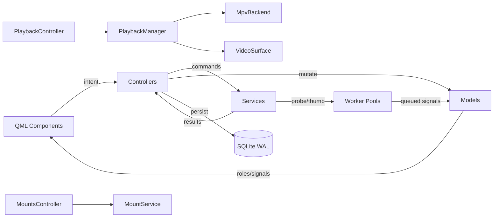

# QG Architecture Overview

## 7-Layer Architecture (Strict Separation)

```
┌─────────────────────────────────────────────────────────────────────────────┐
│ QML Layer (GUI/Render Thread)                                               │
│  Main, PathBar, PlacesSidebar, ContentView, Delegates, Stage, Transport,    │
│  ReelPanel, Strips, Overlays, Dialogs, Theme, Icon                          │
├─────────────────────────────────────────────────────────────────────────────┤
│ Controllers (GUI Thread) — Intent → Behavior/Sequencing/Cancellation        │
│  BrowserController, SearchController, PlaybackController, ActionsController,│
│  MountsController, StateController, ThumbnailController, ProbeController,   │
│  KeyboardFramework, TypeToSelectBuffer                                      │
├─────────────────────────────────────────────────────────────────────────────┤
│ Models (GUI Thread Ownership) — QAbstractItemModel + C++ Value Types        │
│  FolderModel, SearchProxy, ReelModel, PlacesModel, SelectionState           │
├─────────────────────────────────────────────────────────────────────────────┤
│ Services (Worker-Safe) — C++20 Domain Logic, No QML Dependencies            │
│  FilesystemEnumerator, FileOperationsService, TrashService, MountService,   │
│  MediaProbeService, ThumbnailService, PersistenceService, SortService       │
├─────────────────────────────────────────────────────────────────────────────┤
│ Workers (Bounded QThreadPool) — TaskToken Cancellation                       │
│  I/O Pool (min(4,cpu)), CPU/Media Pool (min(cpu,6)), 3 Priorities          │
├─────────────────────────────────────────────────────────────────────────────┤
│ Persistence (SQLite WAL) — Per-Thread Connections                           │
│  paths, media_state, thumbnails, recent_locations, bookmarks, settings,    │
│  collections                                                                │
├─────────────────────────────────────────────────────────────────────────────┤
│ Playback (mpv + Qt Render Thread) — Single Handle, Render API               │
│  MpvBackend, VideoSurfaceItem, PlaybackManager, PlaybackSession,           │
│  PlaybackContext                                                            │
└─────────────────────────────────────────────────────────────────────────────┘
```

## Key Invariants (All Verified)

| # | Invariant | Evidence |
|---|-----------|----------|
| 1 | Filesystem is authoritative | Enumerator filters at source; operations use real paths |
| 2 | One surface, four intensities | ContentView hosts GridView/ListView/Stage; Manifest swaps view |
| 3 | Single ordered source | FolderModel drives Browse, Reel, PlaybackContext identically |
| 4 | One mpv handle | PlaybackManager singleton; MpvBackend sole owner; lazy creation |
| 5 | In-window Cinema | Main.qml `cinema` property; Stage expands; no surface reparenting |
| 6 | GUI thread never waits | Two bounded pools + TaskToken + stale-result rejection |
| 7 | Identity-keyed state | FileIdentity (Inode/Fingerprint/PathOnly); PathRepository reconcile |
| 8 | C++ owns domain | All services/controllers/models in C++; QML binds to properties |

## Component Relationships



## Threading Model

| Pool | Threads | Work |
|------|---------|------|
| I/O | min(4, cpu) | Enumeration, copy/move/trash, mount discovery |
| CPU/Media | min(cpu, 6) | Thumbnail decode, scaling, hashing, media probing |

- **TaskToken**: Monotonic generation + path/identity + atomic cancellation
- **Stale-result rejection**: Every completion validates token + source mtime/size
- **libmpv events**: wakeupCallback → MpvIdleEvent → Qt thread
- **Render thread**: VideoRenderNode (QSGRenderNode) calls mpv_render_context_render()
- **No unsafe cross-thread**: Models mutated only on GUI thread via queued callbacks

## Data Flows

### Open Folder
```
ContentView.activated(path) → BrowserController.navigate()
  → EnumeratorTask (I/O pool, TaskToken) → FolderSnapshot batches
  → BrowserController.onSnapshot() → SortService.apply()
  → FolderModel.applyBatch() → Thumbnail/Probe requestVisible()
  → GridView updates (skeleton → cached thumbs → live content)
```

### Play Video
```
ContentView.activated(video) → PlaybackController.play(identity)
  → Build ordered context from FolderModel (active sort + filter)
  → PlaybackManager.open(path, startPosition)
    → Ensure single mpv handle + render context
    → VideoSurfaceItem presents frames via OpenGL FBO
  → Stage bloom animation; ReelPanel opens at current index
```

### Thumbnail Pipeline
```
Enumeration → Cache lookup (identity + mtime_ns + size)
  → Hit → Model role update
  → Miss → Priority queue (visible → adjacent → background)
    → FFmpeg extraction worker → Validate token + mtime/size
    → Write cache + DB row → Model update via dataChanged
```

## External Dependencies

| Dependency | Purpose | Status |
|------------|---------|--------|
| Qt 6 (Core, Gui, Qml, Quick, QuickControls2, DBus, Concurrent, Test) | Framework, QML, OpenGL | ✅ |
| libmpv | Playback engine, Render API | ✅ |
| SQLite3 | Persistence (WAL mode) | ✅ |
| FFmpeg (libavformat, libavcodec, libavutil, libswscale) | Thumbnails, probing | ✅ |
| GLib/GIO | Trash, Open With, mount enrichment | ✅ |
| UDisks2/QtDBus | Removable volumes, eject | ✅ |
| POSIX / std::filesystem | Filesystem operations | ✅ |
| X11/xcb | Primary platform plugin | ✅ |

## Build & Deployment

- **Language**: C++20, warnings enabled, no exceptions across Qt boundaries
- **Build**: CMake + Ninja; `qt_add_qml_module` for QML compilation
- **Package**: Native Ubuntu `.deb` (executable, QML assets, desktop entry, icons, AppStream)
- **Runtime**: Qt Quick forced to OpenGL backend; X11/xcb primary; Wayland-compatible path retained