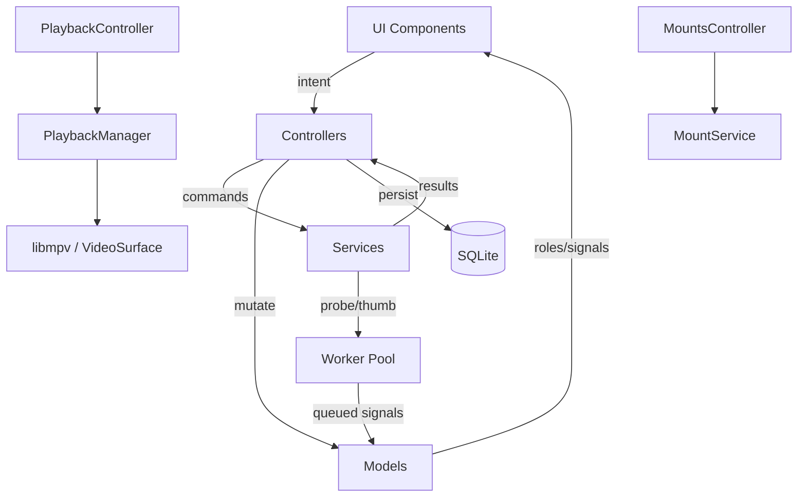
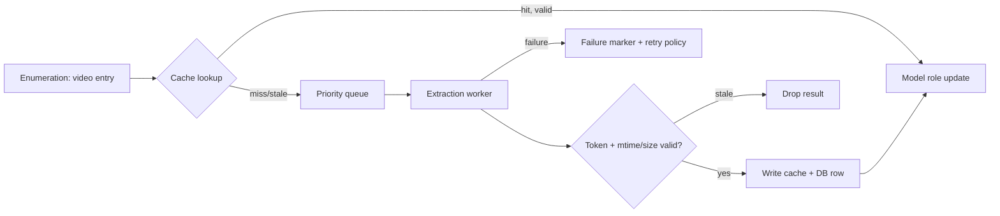

# QG — Product & Technical Design Specification

**Implementation baseline:** C++20 + Qt 6 Quick/QML + libmpv Render API/OpenGL, optimized for Ubuntu/X11.

**QG — Video Explorer for Linux**
A native Ubuntu/Linux video file explorer: browse the real filesystem, find videos fast, play them in place, and keep light organization state — without importing anything into a proprietary library.

| | |
|---|---|
| **Status** | Design specification, v1 (MVP scope) |
| **Platform** | Ubuntu / Linux desktop, C++20, Qt 6 Quick/QML, libmpv Render API |
| **Target sessions** | X11 primary via Qt xcb; Wayland-compatible path retained where practical |
| **Filesystem** | POSIX, mounted volumes, removable drives, network mounts where the kernel/GVfs exposes them |
| **Source of truth** | The filesystem itself. QG never owns or relocates media. |
| **Non-goals (MVP)** | Transcoding, editing, cloud sync, streaming servers, media-library ingestion |

---

## 0. How to read this document

This spec is written so that four readers can each act on it independently:

- A **UI designer** can rebuild every screen from the wireframes, states, tokens, and measurements.
- A **C++ / Qt Quick engineer** can implement the architecture from the module contracts, data flows, and ownership rules.
- A **QA engineer** can derive test cases from the acceptance criteria (§25).
- A **future agent** can extend the product without inventing interaction behavior, because the decisions and their tradeoffs are stated explicitly.

Sections 1–13 are product and interaction. Sections 14–25 are component, architecture, flows, sequencing, and verification. Section numbers match the required output order so nothing is lost, but the content is synthesized rather than restated.

### The five design pillars

1. **Filesystem is the truth.** Folders are folders, files are files. QG overlays *knowledge* (thumbnails, duration, watched, favorite) on top of real paths; it never owns the media.
2. **One surface, four intensities.** Browse, Stage, Cinema, and Manifest are the *same* surface at different intensities — not four applications. Navigating, playing, searching, and going fullscreen must never feel like a mode switch.
3. **Calm by default, chromatic when it matters.** Deep navy depth carries the product. Neon appears only to answer "what is focused, what is playing, what is wrong, what is favorited."
4. **Density is a user choice, not a layout decision.** Gallery / Standard / Compact are explicit, remembered per folder.
5. **The GUI thread never waits.** Every disk read, thumbnail, probe, and search is asynchronous, cancellable, and stale-proof.

---

## 1. Product Design Direction

### 1.1 What QG is

QG is a real Linux file manager. Its specialization is video, which changes three things and only three things:

- **What it shows.** Child directories plus supported video files. Irrelevant regular files (.txt, .pdf, .jpg, .zip…) are hidden. Directories are never hidden, even when they contain no videos.
- **How it looks.** Files become visual cards with thumbnails, duration, size, and date; folders become navigable tiles that sit in the same rhythm.
- **What you can do.** Inline playback, folder-scoped search, and lightweight organization state (favorite, watched) stored *outside* the files.

Everything else is deliberately ordinary file-manager behavior, because that is what users already trust.

### 1.2 The mental model: one surface, four intensities

The central product idea is that QG has **one content surface** and increases its intensity without ever tearing it down:

| Intensity | Trigger | Surface behavior |
|---|---|---|
| **Browse** | default / navigation | Responsive visual grid of folder tiles + video cards |
| **Stage** | play a video | The playing card *blooms* in place into an inline player; the rest of the folder reflows beneath it |
| **Cinema** | fullscreen | The same surface expands to fill the window; chrome fades; playback state is preserved |
| **Manifest** | search active | The same surface tightens into an information-dense, columnar list for rapid scanning |

Going back down an intensity is instant and lossless. Exiting Cinema returns to Stage; clearing search returns to Browse with selection intact; stopping playback *un-blooms* the card back into the grid at the same scroll position. There is no "player window," no "search screen," no "library view." This is the identity that separates QG from both Nemo and YouTube.

### 1.3 Information hierarchy

At every intensity, in priority order:

1. **Where am I?** — location (breadcrumb), always visible.
2. **What is here?** — the entries (grid or manifest), the visual bulk of the window.
3. **What can I do?** — contextual, revealed by hover/focus/selection or a single overflow menu.
4. **What is the status?** — item counts, selection, background activity, playback position.

The rule that keeps QG calm: **the more global an action, the less prominent it is.** Navigation is always present; playback is present only when relevant; destructive and rare actions live behind the overflow menu or a right-click.

### 1.4 How the design balances file manager + video browser + player

- **From the file manager:** reliability, filesystem semantics, keyboard-driven navigation, Trash, native dialogs, permission errors that explain themselves, a sidebar of places, drag and drop, type-to-select.
- **From the video browser:** large legible thumbnails, duration and metadata at a glance, density modes, a scroll experience that rewards visual scanning, hover affordances.
- **From the player:** a real transport, ±10s seek, volume, a seek timeline, previous/next *within the folder's current order*, and a distraction-free Cinema mode.

The balancing mechanism is **progressive disclosure with a stable anchor**. The anchor is the breadcrumb/path bar — it never moves or disappears (even in Cinema the location is one hover away). Every other element may appear or recede. Because the user always knows where they are, the surface is free to change intensity around them.

### 1.5 Explicit tradeoffs

- **Filesystem truth over library convenience.** No import step, no hidden library. Cost: QG cannot guarantee stable IDs across external moves/deletes; we mitigate with inode-based identity and reconcile on rescan (§21).
- **One embedded player over many.** Only one heavy playback session exists. Cost: you cannot preview two videos side by side. Benefit: bounded memory and GPU load, watchable on modest hardware.
- **In-window Cinema over a separate fullscreen window.** Cost: no true multi-monitor fullscreen window in MVP. Benefit: trivial Wayland reliability, zero surface reparenting, instant transitions.
- **Distinct search presentation over a shrunken grid.** Cost: two delegates to maintain. Benefit: desktop-grade scanning speed, which is the whole point of search.
- **Per-folder order memory over a global sort.** Cost: a small persistence surface. Benefit: the folder *is* the playlist, and its order is stable across browser, Reel, and prev/next.

---

## 2. Visual System

### 2.1 Identity in one line

> **Deep ink navy for depth, a single signal blue for intent, and a disciplined neon spectrum reserved for state.**

QG should read as a serious instrument at rest and as an audio-visual machine in motion. Neon is never decoration; it is always a *signal word* — focused, playing, favorited, broken.

### 2.2 Surface hierarchy (depth through value, not shadow)

Depth is built primarily by **value steps within the blue-black family**, so the window remains legible on cheap panels and in bright rooms. Elevation is a support, not the main cue.

| Token | Value | Role |
|---|---|---|
| `--ink` | `#05070D` | Window foundation, fullscreen letterbox, deepest wells |
| `--surface-0` | `#080C15` | Content canvas behind the grid |
| `--surface-1` | `#0E1524` | Panels: sidebar, Reel, status strip |
| `--surface-2` | `#141D31` | Raised: cards at rest, toolbar, popovers |
| `--surface-3` | `#1B2740` | Hover/raised: hovered cards, active menu items |
| `--surface-4` | `#24314F` | Pressed, scrims over content, control tracks |
| `--hairline` | `#22304F` | 1px separators, card edges |
| `--hairline-strong` | `#2E3E63` | Focused/active separators, control outlines |

The canvas (`--surface-0`) is deliberately darker than the panels, so panels read as *closer to the user*. Cards (`--surface-2`) sit above the canvas; hover lifts to `--surface-3`. No region uses a gradient as a body background — gradients are reserved for progress fills and the brand mark.

### 2.3 Text and iconography

| Token | Value | Role | Approx. contrast on its background |
|---|---|---|---|
| `--text-hi` | `#E9EFFB` | Filenames, headings | ~15:1 on `--surface-0` |
| `--text-mid` | `#A9B8D4` | Metadata, secondary labels | ~8:1 on `--surface-1` |
| `--text-low` | `#72829F` | Timestamps, hints, disabled | ~4.6:1 on `--surface-1` (meets AA for small text) |
| `--text-inverse` | `#05070D` | Text on neon fills (chips) | — |

Icons are **monoline, 1.5px stroke, rounded caps, 20px grid** (16 / 20 / 24 sizes). Icons derive color from a single `currentColor`, so a card's icon state is driven by one role at a time. Neon is never used for body text; neon appears only in icon fills, 1px–2px rules, chips, and small badges.

### 2.4 The chromatic system (state, not palette)

QG has **one primary accent and five state neons**. Nothing else is colored.

| Token | Value | Meaning | Where it appears |
|---|---|---|---|
| `--signal` | `#4DA3FF` | **Primary intent** | Selection border/fill, primary buttons, links, breadcrumb current, active sort |
| `--signal-deep` | `#2E6FE0` | Pressed primary | Button press, selected-strong |
| `--focus` | `#38E1E1` (cyan) | **Keyboard focus** | Focus ring (2px), focus cursor, type-to-select highlight |
| `--play` | `#3DE0A0` (mint) | **Live playback** | Playing card ribbon, timeline fill terminus, Reel current marker, pulsing dot |
| `--favorite` | `#FF5CC8` (magenta) | Favorite | Heart glyph only; a small fill, never a border |
| `--watched` | `#9B7BFF` (violet) | Watched / consumed | Check badge; also the desaturate cue's companion |
| `--danger` | `#FF5D6C` (coral) | Destructive / error | Trash in menus, error state icon, permanent-delete confirm |
| `--warn` | `#FFC65C` (amber) | Warning / degraded | Permission warnings, missing-volume badge, partial results |

Rules of engagement:

- A single element uses at most **one** neon at a time. Watched + favorite is expressed as *desaturation (shape cue) + a violet check + a magenta heart* — two tiny glyphs in fixed badge slots, not two borders.
- Selection is **signal blue**, never neon. Neon is for *live/exceptional* states; selection is a normal, frequent, non-exceptional state and must stay calm.
- **Progress** uses a blue→cyan→mint gradient (`--signal → --focus → --play`), so a completed item naturally lands on the "play" color and a full watched bar reads as consumed.
- **No glowing borders.** A glow (`0 0 24px rgba(56,225,225,.25)`) is allowed only for the focus ring and the live-playing card — the two places where "attention" is the literal meaning.

### 2.5 Typography

- UI family: system stack — `"Ubuntu", "Inter", "Noto Sans", system-ui, sans-serif`.
- Numeric/metadata family: same stack with **tabular figures** (`font-variant-numeric: tabular-nums`) so durations, sizes, and dates align in columns.
- Paths and technical strings: `"Ubuntu Mono", "JetBrains Mono", monospace` at 0.92× size.

| Role | Size / weight / spacing | Use |
|---|---|---|
| Display | 22 / 600 / -0.02em | Empty-state titles, About |
| Title | 15 / 600 / -0.01em | Current folder name in the order strip |
| Body | 13 / 500 / 0 | Filenames, menu items |
| Body-strong | 13 / 650 | Folder names, current Reel item |
| Meta | 11.5 / 500 / +0.01em | Duration, size, date |
| Micro | 10 / 650 / +0.06em uppercase | Section labels ("PLACES", "DEVICES", column headers) |

The interface scales with the system font size; all sizes are expressed as relative steps from the base, never hardcoded pixels for text.

### 2.6 Spacing, geometry, radius

- **Spacing scale (px):** 4, 8, 12, 16, 20, 24, 32, 48. Layout gutters use 16/24; intra-card uses 8/12.
- **Radius:** chips/pills `999`, cards `10`, panels `12`, the Stage `14`, menus `10`, buttons `8`, thumbnails `8`.
- **Card thumbnail aspect:** 16:9 (thumbnails are video-shaped). Cards keep a fixed *thumbnail height* and a fixed metadata band, so mixed rows align perfectly.
- **Grid gaps:** 20px wide, 24px tall at Standard density.

### 2.7 Borders, elevation, focus, states

- **Borders:** default 1px `--hairline`; hover 1px `--hairline-strong`; selected 2px `--signal`; focus 2px `--focus` (drawn *inset* so it never shifts layout).
- **Elevation:** `e0` flat, `e1` `0 1px 2px rgba(0,0,0,.45)`, `e2` `0 8px 24px rgba(0,0,0,.5)`, `e3` `0 16px 48px rgba(0,0,0,.6)` (menus/popovers/dialogs). Shadows are black, never colored.
- **Hover states:** raise surface one step, brighten text one step, reveal contextual controls, brighten the thumbnail by +6% exposure. Hover never moves layout and never changes selection.
- **Selected states:** fill `rgba(77,163,255,.10)` + 2px `--signal` border. Multi-select shows the same treatment on every selected item and updates the status strip.
- **Focus states:** 2px cyan ring, inset, always visible for keyboard users, suppressed for pointer users (`Qt.WA_KeyboardFocusChange` semantics). Focus and selection are *independent*: you can focus one card and have a different card selected; the status strip and menus describe selection, arrow keys move focus.
- **Playback states:** playing card gets a 3px mint left ribbon, a pulsing dot on its duration chip, and a subtle mint tint on the thumbnail edge. Paused-in-stage keeps the ribbon but stops the pulse.

### 2.8 Motion

- Durations: micro 120ms, standard 180ms, bloom/collapse 220ms, cinema 260ms. Easing `cubic-bezier(.2,.8,.2,1)`.
- The **card bloom** (card → Stage) cross-fades the thumbnail into the live surface while the card's geometry animates to the Stage rectangle; remaining cards reflow beneath.
- **Respect reduced motion:** if the platform reports reduced animation, bloom becomes an instant swap and pulses become a static dot. No content depends on animation to be understood.

### 2.9 Accessibility

- Body text ≥ 4.5:1, non-text UI (borders, icons conveying meaning) ≥ 3:1. All values above are chosen to clear these on their intended backgrounds.
- **Never color-only.** Watched, favorite, error, and playing all pair a color with a distinct **shape or glyph** (check, heart, warning triangle, play ribbon). A monochrome or color-blind user loses nothing.
- Focus ring is always visible and never clipped; menu navigation is fully keyboard-operable.
- Screen readers: every card exposes a name role announcement, e.g. `"Video, sunset_over_sea.mp4, 4 minutes 12 seconds, 2.1 gigabytes, watched, favorite"`. The Stage exposes transport controls as named buttons and the timeline as a slider with value text.
- A **High-Contrast** variant raises `--surface-*` separations and replaces the neon set with fully saturated, outlined equivalents while keeping semantics.
- Native/portal dialogs inherit the platform palette and system integration; QML surfaces use the same semantic theme tokens so dialogs do not look pasted in.

---

## 3. Main Window Design

### 3.1 Regions

Six regions, top-to-bottom / left-to-right by priority:

1. **Title bar / app identity** — thin; the window uses a normal decorated title bar where the compositor provides one (no custom client-side decoration in MVP). QG does not fight the WM.
2. **Places sidebar** — left. Collapses between a **56px icon rail** and a **240px panel**.
3. **Path Bar** — the full-width anchor row: back / forward / parent / refresh, breadcrumbs (or a path entry), and the right cluster (search, order, density, overflow).
4. **Context strip** — one slim row under the Path Bar: current folder name, item counts, active order, view density. It collapses entirely when the window is narrow.
5. **Content surface** — center. Hosts Browse grid, Manifest search results, or the Stage. This is the only region whose content model changes.
6. **Reel** — right. Ordered list of the containing folder's videos; opens when playback starts, dismissible, remembers per session.
7. **Status strip** — bottom. Selection count, aggregate size, free space of the current volume, background-activity indicator, and transient status text.

### 3.2 Toolbar/header behavior

There is no conventional toolbar. This is deliberate: a toolbar row is the single strongest "web app in a window" signal, and it consumes vertical space that thumbnails want. Instead:

- **Navigation** lives at the left of the Path Bar (icon buttons: back, forward, parent, refresh).
- **Search** is a field that occupies the breadcrumb track when activated.
- **Order**, **Density**, and **Overflow** are grouped at the right edge of the Path Bar.
- **Primary verbs** for the current selection appear contextually — in the card hover chip and in the Reel footer — never as permanent buttons.

The Path Bar therefore behaves as *both* the toolbar and the location interface. This is the main "own identity" decision for the window chrome.

### 3.3 Sidebar behavior

- Two states: **rail** (56px, icons + tooltips) and **panel** (240px, icon + label, grouped).
- Groups, in order: **Pinned** (favorites/bookmarks), **Places** (Home, Videos, Downloads, Desktop, Documents), **Devices** (mounted volumes from `/proc/self/mountinfo` + GVfs), **Recent** (last locations, capped).
- A removable drive shows an eject affordance on hover; a disconnected drive shows an amber badge and greys out, remaining clickable to explain how to remount.
- The sidebar auto-collapses to a rail below 1100px and hides fully below 820px, where it becomes an overlay summoned from the Path Bar's leading button. The chosen width persists.
- Drag a folder onto the sidebar to pin it; drag out to reveal.

### 3.4 Content surface and playback integration

- **Browse:** a Qt Quick `GridView` backed by a C++ `QAbstractListModel`, with lightweight QML delegates for folders and videos; Compact and Manifest use `ListView` presentations over the same canonical model.
- **Manifest:** the same view swapped to a columnar delegate; not a different widget tree.
- **Stage:** a real widget (container + `VideoSurface`) inserted into the grid's layout flow at the position of the playing item, spanning all columns. Remaining cards reflow below. This is the "bloom" and it is what keeps playback inside the browsing context instead of on top of it.
- Selecting a card does **not** start playback. Double-click / Enter starts it.

### 3.5 Resizing and responsive behavior

| Window width | Sidebar | Columns / density | Reel | Context strip |
|---|---|---|---|---|
| ≥ 1500 | Panel (240) | Auto columns, target card 240 | Side panel | Full |
| 1150–1500 | Rail (56) | Auto columns, target 220 | Overlay drawer | Full |
| 900–1150 | Rail (56) | Auto columns, target 200 | Overlay drawer | Compact (name + order) |
| 700–900 | Hidden (overlay) | 2–3 columns, target 190 | Overlay drawer | Hidden |
| < 700 | Hidden | 1–2 columns; Compact rows preferred | Overlay drawer | Hidden |

Column count is `max(1, floor((content_width - gutters) / (min_card + gap)))` with `min_card = 168` and `max_card = 320`. Cards never stretch beyond `max_card`; extra width becomes gutters at the row edges (centered), not stretched thumbnails. This preserves thumbnail aspect on ultrawide displays.

### 3.6 Status/context areas

- The **context strip** answers "what folder, how much, in what order."
- The **status strip** answers "what's selected, is anything busy, did something just happen." Background work is surfaced as a quiet cluster of animated dots plus a count; clicking it opens a small popover listing running tasks (thumbnailing, probing, trashing) with counts, never blocking the UI.
- Transient messages (rename succeeded, moved to Trash, thumbnail failed) appear as **toasts** anchored bottom-center of the content surface, auto-dismiss after 4s, with an **Undo** affordance for Trash.

---

## 4. Main Window Wireframe

Normal first-open / browser state (annotated). Wide layout, Standard density.

```text
┌───────────────────────────────────────────────────────────────────────────────────────────────┐
│  ▣ QG                                                                          ─  □  ✕        │  ← native title bar
├────────────┬──────────────────────────────────────────────────────────────────────────────────┤
│            │  [◂] [▸] [↑] [⟳]   ⌂  ›  Videos  ›  2024  ›  Summer trip          [⌕] [⇅] [▦] [⋯] │  ← PATH BAR
│  PLACES    │                    └────────── breadcrumbs (clickable) ──────┘   search order density │
│            ├──────────────────────────────────────────────────────────────────────────────────┤
│  ★ Pinned  │  Summer trip   ·   42 videos, 3 folders   ·   Name ↑        [◱|▤|▥]               │  ← CONTEXT STRIP
│    Family  │                                                                                  │
│            │  ┌───────────────┐  ┌───────────────┐  ┌───────────────┐  ┌───────────────┐      │
│  ⌂ Home    │  │ ▦  ▦          │  │ ▣ [thumbnail] │  │ ▣ [thumbnail] │  │ ▣ [thumbnail] │      │  ← SHELF (Browse)
│  ▶ Videos  │  │ ▦  ▦   12 ▸  │  │          4:12 │  │          1:03 │  │          9:59 │      │
│  ⬇ Downl.  │  ├───────────────┤  ├───────────────┤  ├───────────────┤  ├───────────────┤      │
│  ▤ Desktop │  │ Summer trip   │  │ sunset_sea.mp4│  │ drone_pan.mp4 │  │ family_hi8.mkv│      │
│  ▤ Docs    │  │ 12v · 3 subs  │  │ 2.1 GB · 2 Jun│  │ 0.7 GB · 1 Jun│  │ 1.4 GB ·28 May│      │
│            │  └───────────────┘  └───────────────┘  └───────────────┘  └───────────────┘      │
│  DEVICES   │                                                                                  │
│  ▣ SSD     │  ┌───────────────┐  ┌───────────────┐  ┌───────────────┐                        │
│  ▣ USB ⏏   │  │ ▣ [thumbnail] │  │ ▣ [thumbnail] │  │ ▣ [thumbnail] │                        │
│  ⟳ NAS     │  │          3:20 │  │          0:41 │  │         12:10 │                        │
│  ⚠ Old HDD │  ├───────────────┤  ├───────────────┤  ├───────────────┤                        │
│            │  │ ...           │  │ ...           │  │ ...           │                        │
│  RECENT    │  └───────────────┘  └───────────────┘  └───────────────┘                        │
│  ~/Pics    │                                                                                  │
│  /mnt/x    │                                                                                  │
├────────────┴──────────────────────────────────────────────────────────────────────────────────┤
│  3 selected · 4.2 GB            Free 220 GB on SSD            ● ● ●  3 background tasks        │  ← STATUS STRIP
└───────────────────────────────────────────────────────────────────────────────────────────────┘
```

Annotation notes:

- `★ Pinned` = user bookmarks; drag-to-pin.
- `⬇ Downl.` labels are truncated in the wireframe for width; real UI ellipsizes.
- `⏏` eject appears on hover for removable devices; `⚠` = disconnected/unmounted volume (amber).
- `[◱|▤|▥]` = density selector (Gallery / Standard / Compact).
- `[⇅]` = Order menu (sort dimension + direction).
- `[⌕]` = search entry; it *replaces the breadcrumb track* when activated (§7).
- Folder tiles show a 2×2 mosaic of child thumbnails plus a count chip; videos show a single 16:9 thumbnail plus a duration chip.
- The `▣` gutter glyph marks thumbnail loading placeholders.

---

## 5. Directory Browser Design

### 5.1 Entries

The browser lists exactly two kinds of entry:

- **Folder entries** — every child directory, always shown, even if it contains no videos.
- **Video entries** — regular files whose extension is in the centrally defined supported set.

Everything else is filtered out at enumeration time (§17), never merely hidden in the view. Filtering at the source keeps sorting, counting, search, and prev/next consistent.

Supported extensions (single source of truth in `media/formats.hpp`, case-insensitive):
`mp4, mkv, webm, avi, mov, m4v, mpeg, mpg, ts, m2ts, mts, ogv, 3gp, flv, wmv`. The MVP set is the required list plus a few safe additions; the list is data, not logic, so it is trivially editable and testable.

### 5.2 Folder representation

Folders are *navigable* and must read as such while sitting in the same grid as videos:

- Same card footprint as a video card, but **no duration chip**.
- Thumbnail area shows a **2×2 mosaic** of up to four pre-resolved child video thumbnails; if fewer than one child thumbnail exists, it shows a calm folder glyph on `--surface-3` (never a broken image).
- A **count chip** in the top-right of the thumbnail area: `12v` for videos, `12v · 3` when subfolders exist.
- The label is **Body-strong** (bolder than a video filename) and the meta line reads `12 videos · 3 subfolders`.
- On hover, the tile reveals a subtle `▸` "enter" affordance; the chevron is an *affordance*, not a separate button.
- Dissimilarity is intentional and small: same geometry, different content and weight. Folders feel like doors among photographs, not like a different species.

### 5.3 Video entries

Covered in detail in §6.

### 5.4 Grid / list behavior

- **Gallery:** large cards, 1–3 columns typical, minimal metadata (name + duration).
- **Standard (default):** 3–6 columns typical, full metadata line.
- **Compact:** row list — 96×54 thumbnail, name, duration, size, date, and state badges in aligned columns. This is the escape hatch for power users and for narrow windows; it is *not* the search Manifest (see §7 for how they differ).
- Density is remembered per folder, defaulting to Standard.

### 5.5 Selection, hover, focus

- **Hover:** lifts the card, brightens the thumbnail, reveals a quick-action chip (play, favorite) and the overflow dot. Hover never changes selection.
- **Click:** selects (replacing selection). **Ctrl+click:** toggles. **Shift+click / Shift+arrows:** range. **Ctrl+A:** all. **Escape:** clear selection (or leave search first — see §13 for ordering).
- **Focus cursor:** a separate keyboard-driven highlight (cyan ring). Typing a letter performs type-to-select within the focused view. This is standard Linux file-manager behavior and is essential for large folders.
- Selection is signal blue; focus is cyan; playing is mint. All three can coexist on different cards, and on the same card only two can (playing + selected) — the ribbon and border occupy different edges so they never merge.

### 5.6 Metadata hierarchy on cards

Per card, in visual order of attention:

1. **Thumbnail** (primary recognition).
2. **Filename** (one line, ellipsized in the middle: `summer_trip_final…v2.mp4`).
3. **Duration** (on the thumbnail, bottom-right chip; the single most important number).
4. **Size** and **modified date** (meta line).
5. Optional, on hover or in Compact: **resolution** chip (`1080p`, `4K`), and state badges (favorite heart, watched check).

### 5.7 Sorting

Sort is a **first-class, per-folder property**, chosen from the Order menu:

`Name ↑/↓` · `Modified ↑/↓` · `Duration ↑/↓` · `Size ↑/↓` · `Watched ↑/↓` · `Favorite ↑/↓`

- The default for a previously unseen folder is **Name ascending**; folders always sort **before** videos within any sort mode (they are navigation) — except when the user explicitly picks a metadata sort, in which case folders are grouped first only if `Group folders first` is enabled (default **on**).
- The chosen sort is persisted per directory path and applies to the **browser, the Reel, and prev/next** identically. This is the key consistency guarantee (§20).
- Sorting is a deterministic, stable total order. Ties break by name, then by absolute path, so results never jitter.

### 5.8 Browser wireframe

```text
Standard density, selection on one card, keyboard focus on another, one item playing.

┌───────────────────────────────────────────────────────────────────────────────────┐
│ [◂][▸][↑][⟳]  ⌂ › Videos › 2024 › Summer trip                  [⌕] [⇅ Name ↑] [▦]│
├───────────────────────────────────────────────────────────────────────────────────┤
│ Summer trip · 42 videos, 3 folders · Name ↑                          [◱|▤|▥]     │
├───────────────────────────────────────────────────────────────────────────────────┤
│ ┌───────────────┐ ┌═══════════════╗ ← selected (2px signal)  ┌───────────────┐     │
│ │ ▦ ▦           │ ║ ▣ ▶ [thumb]   ║                      │ ▣ [thumb]      │     │
│ │ ▦ ▦     12 ▸  │ ║         4:12  ║                      │         3:20  │     │
│ ├───────────────┤ ║ ┄┄┄┄┄┄┄┄┄┄┄┄┄  ║ ← cyan focus ring    ├───────────────┤     │
│ │ Summer trip   │ ║ sunset_sea.mp4║                      │ drone_pan.mp4 │     │
│ │ 12v · 3 subs  │ ║ 2.1 GB · 2 Jun║                      │ 0.7 GB · 1 Jun│     │
│ └───────────────┘ └═══════════════╝                      └───────────────┘     │
│                                                                                   │
│ ┌───────────────┐ ┌───────────────┐ ┌───────────────┐                             │
│ │ ▣ [thumb]     │ │ ▣ [thumb]     │ │ ▣ [thumb]     │                             │
│ │ ▎      6:07  ●│ │         0:41  │ │        12:10  │  ← ▎mint ribbon + ● pulsing │
│ ├───────────────┤ ├───────────────┤ ├───────────────┤     = currently playing     │
│ │ beach_walk.mp4│ │ clip_card.mov │ │ lecture_01.mp4│                             │
│ │ 1.2 GB ·28 May│ │ 0.4 GB ·28 May│ │ 2.9 GB ·27 May│                             │
│ └───────────────┘ └───────────────┘ └───────────────┘                             │
├───────────────────────────────────────────────────────────────────────────────────┤
│ 1 selected · 2.1 GB                        Free 220 GB on SSD     ● 1 task       │
└───────────────────────────────────────────────────────────────────────────────────┘
```

Selection (signal) and focus (cyan) are shown as different weights here; in the real UI the focused card's ring is inset and does not change the card's outer geometry.

---

## 6. Video Card Design

### 6.1 Anatomy

```text
┌─────────────────────────────┐
│  ╔═══════════════════════╗  │  ← thumbnail well, 16:9, radius 8
│  ║  [ frame / placeholder]║  │
│  ║  ♥(fav)        ⏱ 4:12  ║  │  ← favorite badge (TL), duration chip (BR)
│  ╚═══════════════════════╝  │
│  ✓(watched)                 │  ← watched badge overlays TL below favorite, or TL slot when no fav
│  sunset_over_sea.mp4        │  ← filename, 1 line, middle-ellipsized
│  2.1 GB · 2 Jun 2026 · 1080p│  ← meta line (resolution only in Standard/hover)
└─────────────────────────────┘
   ▲ hover quick-actions appear at TR of the thumbnail well:
     [▶ play] [⋯ overflow]
```

- The thumbnail well is the only region that changes size between densities.
- The duration chip is `rgba(5,7,13,.72)` with `--text-hi`, 10px micro type, pill radius — readable over any frame.
- Badge slots are **fixed** (favorite top-left, watched immediately below it, quick-actions top-right, duration bottom-right). Fixed slots are why states combine without clutter: two badges never overlap and never move the frame.

### 6.2 State matrix

| State | Visual |
|---|---|
| **Idle** | Thumbnail at 100% exposure; 1px `--hairline`; meta in `--text-mid`. |
| **Hovered** | Surface `--surface-2 → --surface-3`; thumbnail +6% exposure; 1px `--hairline-strong`; play glyph fades in centered at 60% opacity; quick-action chip appears TR; card lifts via `e1`. Layout unchanged. |
| **Focused (keyboard)** | Inset 2px `--focus` ring. Independent of selection. |
| **Selected** | 2px `--signal` border + `rgba(77,163,255,.10)` fill; filename steps to `--text-hi`. Multi-select shows on all selected cards. |
| **Playing** | Card *becomes* the Stage (thumbnail replaced by live surface). In its collapsed/minimized form (e.g., in the Reel or Compact), it shows a mint left ribbon, mint border, and a pulsing dot on the duration chip. |
| **Paused in Stage** | Ribbon stays mint; pulse stops; play glyph shown large in the Stage center. |
| **Favorite** | Magenta heart glyph, top-left badge. Small fill only. Also adds a `Favorite ↑` sortability and a Reel filter. |
| **Watched** | Thumbnail desaturated ~25% (a shape/value cue, colorblind-safe), violet check badge, and a full-width 3px `--play→--watched` progress bar along the thumbnail bottom = 100%. Filename dims to `--text-mid`. |
| **Unwatched (after watched)** | Returns to normal exposure; progress bar hidden until the next partial playback. |
| **Partially watched** | A 3px progress bar along the thumbnail bottom, filled to `last_position/duration`, using the blue→mint gradient. This is the resume cue. |
| **Thumbnail missing/loading** | Placeholder on `--surface-3` with a faint filmstrip glyph; optional shimmer only if motion is allowed. Never a broken-image icon. |
| **Thumbnail failed** | Placeholder with an amber filmstrip-slash glyph; tooltip explains the failure and offers "Retry thumbnail". |
| **Unreadable / permission** | Card renders with filename and meta but a dimmed placeholder and a small amber lock badge; playback/thumbnail actions are disabled with tooltips. |

### 6.3 Combining states without clutter

Because every state is assigned to a **named zone** (`border`, `thumbnail exposure`, `left ribbon`, `top-left badge`, `bottom progress`, `bottom-right chip`, `top-right actions`), the maximum simultaneous load is: one border treatment, one exposure adjustment, one ribbon, one badge, one progress bar, one chip, and one action chip. That is visually dense but spatially organized, so the eye reads "watched, favorite, playing, selected" at a glance without a kaleidoscope.

### 6.4 Card wireframe (state gallery)

```text
IDLE                    HOVER                    SELECTED
┌───────────────┐       ┌───────────────┐        ┌┅┅┅┅┅┅┅┅┅┅┅┅┅┅┅┐
│ ▣ [frame] 4:12│       │ ▣ [frame] ▶4:12│       ┅ ▣ [frame] 4:12┅
├───────────────┤       ├───────────────┤        ┅───────────────┅
│ sunset_sea.mp4│       │ sunset_sea.mp4│        ┅ sunset_sea.mp4┅
│ 2.1GB · 2 Jun │       │ 2.1GB · 2 Jun │        ┅ 2.1GB · 2 Jun ┅
└───────────────┘       └───────────────┘        └┅┅┅┅┅┅┅┅┅┅┅┅┅┅┅┘
                                                (2px signal border)

WATCHED                 FAVORITE                 PLAYING (in Stage)
┌───────────────┐       ┌───────────────┐        ╔═══════════════════╗
│ ✓ ▣ [dim 75%] │       │ ♥ ▣ [frame]   │        ║ ▎ live mpv surface║
│ ▓▓▓▓▓▓▓▓▓▓ 4:12│       ├───────────────┤        ║   ▶      0:00/4:12║
├───────────────┤       │ sunset_sea.mp4│        ╚═══════════════════╝
│ sunset_sea.mp4│       │ 2.1GB · 2 Jun │          mint ribbon + pulse
│ 2.1GB · 2 Jun │       └───────────────┘
└───────────────┘
  (violet check, full progress)
```

---

## 7. Search Experience

### 7.1 Entry and scope

- Invoke with **Ctrl+F** or the `⌕` button. The breadcrumb track **morphs into the search field** — same row, same width, no new bar appears. This preserves the "one surface" feel and keeps vertical space for content.
- A **scope chip** sits inside the field: `This folder` for MVP. The control exists in the architecture and UI from day one, with `Subfolders` present-but-disabled and labeled "coming soon," so recursive search (§27) is a capability flip, not a redesign.
- Typing filters **incrementally** (debounced ~80ms) against the already-enumerated entries of the current directory. No disk I/O during typing — this is why it stays instant even in huge folders.
- Matching is **case-insensitive** by default, substring based, with a bonus rank when the match is at the start of a word or the whole filename.
- A live count appears in the field: `🔎 sunset — 6 results`.

### 7.2 Search-active state

- When search activates, the surface enters the **Manifest** intensity: the grid tightens into a columnar result list (§7.3).
- The context strip is replaced by a result summary: `6 results for "sunset" in Summer trip · Name ↑`.
- **Escape** clears the query; a second Escape leaves the field. Clearing restores Browse instantly with the previous scroll position and selection.
- The `✕` in the field clears; a `Cancel` on the right edge exits search entirely.
- The current search query is **not** persisted between sessions (it is a transient find, like a file manager's).

### 7.3 Manifest (search result) layout

Designed for scanning, deliberately different from the grid:

| Column | Width | Content |
|---|---|---|
| Thumb | 96×54 fixed | Small 16:9 frame; placeholder otherwise |
| Name | flexible, 1.6fr | Filename with the **matched substring** highlighted in `--signal`; second line shows the containing path in `--text-low` monospace |
| Duration | 72px, tabular | `4:12` |
| Size | 88px, tabular | `2.1 GB` |
| Modified | 120px, tabular | `2026-06-02 14:31` |
| State | 56px | heart / check glyphs |
| Actions | 32px | overflow dot, appears on row hover/focus |

- A fixed **header row** with clickable sort headers (secondary entry point to Order; it stays synchronized with the Order menu).
- Zebra striping is **not** used; instead rows get a 1px `--hairline` separator and hover lifts the row to `--surface-2`.
- Row height is 64px (thumb 54 + padding) — dense enough to fit ~10 rows on a laptop, sparse enough to stay legible.
- **Enter / double-click** plays the row. **←/→** are reserved (no horizontal nav); **↑/↓** move the row focus; **Type** does find-as-you-type.
- Folders matching the query are shown as manifest rows too, at the top (they are navigation), with a folder glyph and no duration.

### 7.4 No-results state

- Centered, calm: a dimmed magnifier glyph, `No matches for "sunset"` in Body, and two secondary actions: **Clear search** and, in a future scope, **Search subfolders**.
- Critically, it does **not** say "No videos found." Search speaks about *matches*, not about the directory's video content.

### 7.5 Search wireframes

```text
SEARCH ACTIVE (Manifest)
┌─────────────────────────────────────────────────────────────────────────────────┐
│ [◂][▸][↑][⟳]  🔎 "sunset"                     [This folder ▾]  ✕   Cancel       │
├─────────────────────────────────────────────────────────────────────────────────┤
│ 6 results for "sunset" in Summer trip · Name ↑                                  │
├──────────┬────────────────────────────────┬────────┬────────┬───────────────────┤
│ THUMB    │ NAME                           │  TIME  │  SIZE  │  MODIFIED         │
├──────────┼────────────────────────────────┼────────┼────────┼───────────────────┤
│ [▣]      │ sunset_over_sea.mp4            │  4:12  │ 2.1 GB │ 2026-06-02 14:31  │
│          │ ~/Videos/2024/Summer           │        │        │                   │
├──────────┼────────────────────────────────┼────────┼────────┼───────────────────┤
│ [▣]      │ sunset_timelapse_final.mkv     │ 12:40  │ 8.9 GB │ 2026-05-18 09:02  │
│          │ ~/Videos/2024/Timelapses       │        │        │                   │
├──────────┼────────────────────────────────┼────────┼────────┼───────────────────┤
│ [▣]      │ morning_beach_sunset.mov       │  1:44  │ 0.8 GB │ 2026-04-27 20:15  │
│          │ ~/Videos/2024/Summer           │        │        │                   │
└──────────┴────────────────────────────────┴────────┴────────┴───────────────────┘
       ↑ matched substring highlighted in signal blue

NO RESULTS
┌─────────────────────────────────────────────────────────────────────────────────┐
│ [◂][▸][↑][⟳]  🔎 "xyz"                        [This folder ▾]  ✕   Cancel       │
├─────────────────────────────────────────────────────────────────────────────────┤
│                                                                                 │
│                                    ⌕                                            │
│                         No matches for "xyz"                                    │
│                                                                                 │
│                      [ Clear search ]     [ Search subfolders (soon) ]          │
│                                                                                 │
└─────────────────────────────────────────────────────────────────────────────────┘
```

---

## 8. Inline Playback Experience

### 8.1 Transition from thumbnail to playback

1. User double-clicks / presses Enter on a card (or plays from the Reel / hover chip).
2. The controller resolves the **ordered video list** of the containing folder under the active sort (§20) and locates the item's index.
3. The card **blooms**: its thumbnail cross-fades into the `VideoSurface`; the card expands to a Stage rectangle spanning the content width at a 16:9 height (capped at ~60% of the content height, and by available width).
4. Remaining cards reflow beneath the Stage with a 220ms ease.
5. The **Reel** slides in on the right (unless the window is narrow, where it becomes an overlay drawer).
6. Playback begins automatically; the transport fades in and then auto-hides after 2.5s of pointer inactivity, leaving a clean frame with a small persistent position chip.

If the file cannot be opened, the card shows an inline **playback failure** state (§12) rather than a modal dialog.

### 8.2 Controls and hover behavior

- **At rest:** only a slim position chip bottom-right (`1:12 / 4:12`) and the mint ribbon remain.
- **On hover / keyboard focus / movement:** the full transport fades in over a bottom scrim (`linear-gradient(transparent, rgba(5,7,13,.85))`), so it stays readable over bright frames.
- **Auto-hide:** 2.5s after the last input (pointer move over the stage or any key). Hidden does **not** mean unreachable: Tab focuses the controls and pins them visible.
- The transport is a single row of controls on a `--surface-4` track with 12px radius, inset 12px from the Stage edges.

### 8.3 Required controls

| Control | Glyph | Behavior | Shortcut |
|---|---|---|---|
| Play / Pause | ▶ / ⏸ | Toggle | `Space`, `K` |
| Previous media | ⏮ | Previous video in folder order | `Shift+←` , `,` |
| Next media | ⏭ | Next video in folder order | `Shift+→`, `.` |
| Rewind 10s | ⟲10 | Seek −10s | `←`, `J` |
| Forward 10s | ⟳10 | Seek +10s | `→`, `L` |
| Seek timeline | scrubber | Click/drag to seek; hover shows scrub tooltip with time; future: hover thumbnail | `0–9` jump to % |
| Volume | 🔊 slider | 0–100%; mute toggle on icon | `↑/↓`, `M` mute |
| Fullscreen | ⛶ | Enter Cinema | `F11`, `F` (stage-focused) |
| Stop / close stage | ✕ | Un-bloom back to the grid | `Esc` |

- The timeline shows **buffered range** and **last-known duration**; while probing happens in the background the timeline is indeterminate (hatched track) rather than jumpy.
- Seek gestures are **optimistic**: the scrubber moves immediately and the seek is coalesced to the latest value; if `seekable=false`, the scrubber snaps back with a brief amber flash.
- **Previous/Next are playlist-context operations**, distinct from seek: they change the media, preserve the Stage geometry, and always respect the folder's active sort.

### 8.4 Inline playback wireframe

```text
┌───────────────────────────────────────────────────────────────────────┬───────────────┐
│ [◂][▸][↑][⟳]  ⌂ › Videos › 2024 › Summer trip         [⌕] [⇅] [▦] [⋯]│  REEL         │
├───────────────────────────────────────────────────────────────────────┤  Summer trip  │
│                                                                       │  Friends ↑    │
│ ╔═══════════════════════════════════════════════════════════════════╗ │ ───────────── │
│ ║                                                                   ║ │ 1 clip_01 3:02│
│ ║                    ▣  mpv surface                                 ║ │ 2 clip_02 0:41│
│ ║                                                                   ║ │▸3 clip_03 4:12│ ← current
│ ║    ‹                                                        ›     ║ │ 4 clip_04 2:55│
│ ║                                                                   ║ │ 5 clip_05 0:12│
│ ╚═══════════════════════════════════════════════════════════════════╝ │ ...           │
│ ┌───────────────────────────────────────────────────────────────────┐ │ ───────────── │
│ │ ⏮ ▶ ⏭   ⟲10 ⟳10   ────●─────────────  1:12 / 4:12   🔊 ────  ⛶ ✕│ │ ‹ prev  next ›│
│ └───────────────────────────────────────────────────────────────────┘ │               │
│ ┌───────────────┐ ┌───────────────┐ ┌───────────────┐                 │ [♥  ⧉ filter] │
│ │ ▣ [thumb]     │ │ ▣ [thumb]     │ │ ▣ [thumb]     │  ← grid reflows  │               │
│ │ clip_04  2:55 │ │ clip_05  0:12 │ │ clip_06  0:33 │  beneath Stage  │               │
│ └───────────────┘ └───────────────┘ └───────────────┘                 │               │
├───────────────────────────────────────────────────────────────────────┴───────────────┤
│ Playing clip_03.mp4 · 3 / 42                                     Free 220 GB on SSD  │
└───────────────────────────────────────────────────────────────────────────────────────┘
```

---

## 9. Fullscreen Experience

### 9.1 Model: in-window Cinema

Fullscreen is **not** a new window. It is the main window entering **Cinema state**:

- The title bar (where client-side), sidebar, Path Bar, context strip, Reel, status strip, and any surrounding chrome hide.
- The Stage expands to fill the entire window, letterboxing the video in `--ink` (true black) via the surface's aspect handling.
- Playback is **continuous** — same session, same position, same volume, same pause state. There is no reload and no re-buffer.
- This design is chosen for practical Wayland reliability: no surface reparenting, no `wid` juggling, no focus surprises. (A true multi-monitor fullscreen window is a listed future extension; the `PlaybackSession` API already supports it because Cinema is just a layout state.)

### 9.2 Controls and overlay behavior

- **Top info bar** (fades): filename · containing path · `7 / 42` playlist position. Auto-hides with the bottom controls.
- **Bottom transport**: same control set as inline, but larger hit targets and a taller timeline; volume expands on hover.
- **Cursor hiding:** after 2s of no pointer movement, the cursor hides; any movement shows it with the controls.
- **Wake:** moving the mouse, pressing any transport key, or scrolling.
- **Exit:** `Esc` exits Cinema to Stage; `F11`/`F` toggles; double-click toggles; a `✕` in the top bar exits Cinema *and* stops playback (explicit close).
- **Next video ends in Cinema:** if the next item is reached, Cinema **stays** in Cinema and loads the next item into the same session (this is what users expect from a folder-as-playlist).

### 9.3 Transition model

```text
Browse ──play──▶ Stage ──F11/F/dblclick──▶ Cinema
   ▲               ▲                         │
   │               └──── Esc / ✕(exit) ──────┘
   └──── Esc / ✕(stop) ──── (un-bloom to grid at same scroll position)
```

Cinema → Stage preserves geometry, transport position, and focus context. Stage → Browse preserves the grid scroll position and selection.

### 9.4 Fullscreen wireframe

```text
┌───────────────────────────────────────────────────────────────────────────────────┐
│  sunset_over_sea.mp4   ·   ~/Videos/2024/Summer trip   ·   7 / 42            [✕]   │ ← top bar (fades)
│                                                                                   │
│                                                                                   │
│                                                                                   │
│                         ▣   video letterboxed in deep ink                         │
│                                                                                   │
│                                                                                   │
│                                                                                   │
│  ┌─────────────────────────────────────────────────────────────────────────────┐  │
│  │  ⏮   ▶   ⏭    ⟲10   ⟳10     ──────────●──────────────  1:12 / 4:12   🔊 ⛶  │  │ ← transport (fades)
│  └─────────────────────────────────────────────────────────────────────────────┘  │
└───────────────────────────────────────────────────────────────────────────────────┘
   cursor + all chrome hide after 2s idle; any movement restores them.
```

---

## 10. Folder / Playback Context Panel (the Reel)

### 10.1 Purpose

The Reel answers: *"what else is in the folder I'm playing from, in what order, and where am I in it?"* It exists so that Previous/Next is **understandable** without turning QG into a playlist-centric player. It is a *view of the containing folder*, not a user-authored playlist.

### 10.2 Behavior

- Opens automatically when playback starts; toggled with `Ctrl+R`; dismissible with its `✕` or by Esc when nothing is playing (Esc stops playback first).
- Header shows the folder name, the **active sort** (e.g., `Friends ↑` — a person's name doubles as an order and a label, so it reads naturally), playlist position `7 / 42`, and a small filter control.
- The list is **the folder's ordered video list under the active sort** — identical source to prev/next (§20). It excludes child folders.
- The current item is anchored: on open and on media change, the Reel scrolls the current item into view with a mint left marker and bold label.
- Rows show index, filename, duration, and state badges (favorite/watched). Partial-watch progress appears as a thin bar under the row.
- Footer has **‹ prev** and **next ›** and a compact favorite toggle for the current item.
- The Reel is **not** an editor: no reordering in MVP. Reordering would imply a user playlist, which is explicitly a future feature.
- Filtering (`All / Favorites / Unwatched`) changes what the Reel and prev/next traverse. This is a *playback context filter*, shown clearly at the top so the user never wonders why Next skipped a file.

### 10.3 Reel wireframe

```text
┌───────────────────────┐
│ REEL              [✕] │
│ Summer trip           │
│ sorted: Name ↑        │
│ ───────────────────── │
│ [ All | ♥ Fav | ○ Unw ]│
│ ───────────────────── │
│  1  clip_01.mp4  3:02 │
│  2  clip_02.mp4  0:41 │
│▸ 3  clip_03.mp4  4:12 │  ← current: mint bar + bold
│  4  clip_04.mp4  2:55 │
│  5  clip_05.mp4  0:12 │
│  6  clip_06.mp4  0:33 │
│  …                    │
│ ───────────────────── │
│  ‹ prev    ♥     next ›│
└───────────────────────┘
```

---

## 11. File Actions and Context Menus

### 11.1 Action hierarchy

Actions are placed by frequency × reversibility × risk. The rule: **the more destructive or the rarer, the deeper it lives.**

| Action | Primary placement | Also available | Shortcut | Risk |
|---|---|---|---|---|
| **Play / Open** | card hover chip, Enter | context menu, Reel | `Enter` | none |
| **Favorite** | card hover chip (heart), Reel footer | context menu | `Ctrl+Shift+F` | none, reversible |
| **Mark Watched / Unwatched** | context menu | Reel row menu, `W` on focused card | `Ctrl+Shift+W` | none |
| **Rename** | context menu, inline | `F2` | `F2` | low |
| **Trash** | context menu (coral, split section) | card overflow | `Delete` | medium, undoable |
| **Move / Copy** | context menu | drag & drop | `Ctrl+X` / `Ctrl+C` + `Ctrl+V` | medium |
| **Reveal in Folder** | context menu | — | `Ctrl+Shift+R` | none |
| **Open With…** | context menu | — | — | none |
| **Properties** | context menu | — | `Alt+Enter` / `Ctrl+I` | none |
| **Add to Collection** | context menu (future) | — | — | none |
| **Permanent Delete** | overflow → confirm dialog | context menu | `Shift+Delete` | high, always confirmed |

Notes:

- Only **Play** and **Favorite** earn permanent (hover) real estate, because they are the two most frequent non-navigational acts. Everything else is contextual.
- Trash is **never** a hover control. It must be a deliberate menu gesture, and it is visually separated in the menu (a divider) and colored coral.
- **Move/Copy** are implemented as clipboard + paste for keyboard users and drag-and-drop for pointer users; pasting into the current folder is the common case.
- **Open With…** uses GIO/GDesktopAppInfo (and the desktop portal where appropriate) to enumerate registered applications; QG does not maintain its own MIME database.
- **Add to Collection** appears in the menu from day one but is **disabled with a "coming soon" hint** until collections ship — the menu shape is stable so later features don't reshuffle muscle memory.

### 11.2 Menu structure

A single menu, grouped by spatial rhythm (dividers), verbs first, destructive last:

```text
┌──────────────────────────────────────┐
│  ▶  Play                             │
│  ♥  Favorite              Ctrl+Shift+F│
│  ✓  Mark Watched          Ctrl+Shift+W│   ← toggles to "Mark Unwatched"
│  ────────────────────────────────────│
│  ✎  Rename                       F2  │
│  ✂  Cut                     Ctrl+X   │
│  ⧉  Copy                    Ctrl+C   │
│  ↪  Reveal in Folder   Ctrl+Shift+R  │
│  ⊞  Open With…                       │
│  ★  Add to Collection…        (soon) │   ← disabled
│  ────────────────────────────────────│
│  ⓘ  Properties              Alt+Enter│
│  ────────────────────────────────────│
│  🗑  Move to Trash              Del   │   ← coral
│      Delete Permanently    Shift+Del │   ← coral, opens confirm
└──────────────────────────────────────┘
```

For multiple selection, the menu keeps only the bulk-capable verbs (Favorite, Watched, Cut/Copy, Trash) and shows `3 items` in the title row.

### 11.3 Inline rename

Rename happens **in place on the card label** (`F2`), not in a modal:

- The filename becomes an inline Qt Quick `TextField` sized to the label; the **extension is shown but locked** (dimmed, unselected region) so it is preserved by default.
- A small toggle (or `Tab`) unlocks the extension for the rare case.
- **Validation is live:** invalid characters (`/`, NUL), empty names, names beginning with `-`, and reserved paths are rejected with an inline error and a red underline.
- **Collision detection** checks the target against the directory listing (case-insensitively on case-insensitive filesystems) and reports `A file named "X" already exists` before commit.
- **Commit:** Enter / focus-out. **Cancel:** Esc.
- On success the model row updates in place (no full refresh), the identity mapping is recorded old→new path, and the thumbnail/probe caches are **re-keyed by identity**, not discarded (§18, §21).
- On a filesystem error (permissions, read-only mount, cross-device), a toast explains the cause and the name reverts.

### 11.4 Bulk actions

Multi-select enables bulk Favorite / Watched / Cut / Copy / Trash. Bulk Trash reports progress per item in the status strip and offers a single Undo. A partial failure in a bulk operation produces a result summary toast: `Moved 9 of 10 to Trash — 1 permission error` with a "Details" expansion, never a modal per item.

---

## 12. Empty / Error / Loading States

All states follow the same shape: **glyph + one-line truth + one-line explanation + one primary action**, centered in the content surface, on `--surface-0`, without illustration noise. The wording never lies: an empty folder is "empty," a permission problem says so, and a disconnected drive says which one.

| State | Glyph / color | Headline | Body | Primary action |
|---|---|---|---|---|
| **Empty directory** | dimmed filmstrip | `This folder is empty` | `No videos or subfolders here.` | `Go to Home` |
| **Folder-only directory** | *no empty state* | — | The grid shows the child folders; the context strip reads `0 videos · N folders`. The string "No videos found" is **forbidden** here. | — |
| **No videos but subfolders** | dimmed filmstrip | *(none — folders render)* | Folders are a valid result and are shown normally. | — |
| **Access denied** | amber lock | `You don't have permission to open this folder` | `Try opening it as the owner, or check its permissions.` | `Properties` · `Copy path` |
| **Missing / disconnected drive** | amber plug-slash | `"Old HDD" is not connected` | `Reconnect the drive and QG will resume.` | `Retry` · `Eject` |
| **Loading (enumeration)** | animated ring | *(no headline)* | A skeleton grid of placeholder cards appears immediately; a thin indeterminate bar sits under the Path Bar. Existing interaction (sidebar, Path Bar, search entry) stays live. | — |
| **Loading (partial)** | — | — | Entries stream in in batches; a `Loading…` line remains at the grid's end until enumeration completes. | `Cancel` |
| **Search: no results** | dimmed magnifier | `No matches for "xyz"` | *(scope line)* | `Clear search` · `Search subfolders (soon)` |
| **Thumbnail failure** | amber filmstrip-slash | *(in-card)* | Tooltip: `Thumbnail couldn't be generated.` | `Retry` (context menu) |
| **Media probe failure** | amber dot on duration chip | duration shows `--:--` | Tooltip explains; playback still offered (mpv may still open it). | `Play anyway` |
| **Playback failure** | coral warning in Stage | `Can't play this file` | `The file may be corrupted, unsupported, or on a disconnected volume.` | `Open With…` · `Reveal in Folder` · `Next` |
| **Operation error (rename/trash/move)** | coral | short cause | recovery hint | context action + `Dismiss` |

Design notes:

- **Loading never blocks.** The skeleton grid is interactive; sidebar navigation and search remain available; navigating away cancels the pending enumeration.
- **Errors are recoverable, not terminal.** Every error state offers at least one action that moves the user forward.
- Unknown/decoding errors surface the underlying message in a collapsible "Details" area, because Linux users expect to read the real error.

---

## 13. Keyboard and Focus Model

### 13.1 Focus model

Three independent concepts, deliberately separated:

- **Focus** (cyan ring) — the keyboard cursor; moves with arrows/Tab; determines where typing and shortcuts apply.
- **Selection** (signal border) — the action target; set by click/Space/Ctrl+click/Shift+range; what the status strip and menu describe.
- **Playback state** (mint) — independent of both; playback continues while you browse elsewhere.

This separation is what makes QG usable without a mouse: you can browse (focus) while a file is selected and a different one is playing.

### 13.2 Shortcut map

**Navigation**

| Action | Shortcut |
|---|---|
| Back / Forward | `Alt+←` / `Alt+→` |
| Parent directory | `Alt+↑` or `Backspace` |
| Refresh | `F5` or `Ctrl+R` |
| Focus location / path entry | `Ctrl+L` |
| Go Home | `Alt+Home` |
| Places panel toggle | `F9` |
| Reel toggle | `Ctrl+R`… *(conflict)* → see note |

> **Note on conflicts.** `Ctrl+R` is a natural "refresh" in file managers *and* a natural "context panel" in players. QG resolves it deliberately: **`F5` = refresh**, **`Ctrl+R` = toggle Reel**, and `Ctrl+L` = location. `Alt+↑` plus `Backspace` both go to parent (Nautilus and Windows Explorer agree on Backspace). This is documented in-app under Help → Shortcuts.

**Search**

| Action | Shortcut |
|---|---|
| Search current folder | `Ctrl+F` |
| Clear search (keep focus) | `Esc` |
| Leave search / restore browse | `Esc` again, or `Cancel` |

**Selection & opening**

| Action | Shortcut |
|---|---|
| Open folder / play video | `Enter` |
| Select / toggle | `Space` (selection), `Ctrl+Space` (toggle) |
| Select all | `Ctrl+A` |
| Clear selection | `Esc` |
| Add to selection | `Ctrl+Click` |
| Range select | `Shift+Click`, `Shift+↑/↓` |
| Type-to-select | any printable key while the view is focused |

> **Note.** `Space` is *selection* while browsing (native file-manager semantics) and *play/pause* while the Stage has focus. This context-sensitivity is the standard resolution of the conflict and is stated in the Help overlay.

**Playback**

| Action | Shortcut |
|---|---|
| Play / Pause | `Space` (Stage focused), `K` |
| Play selection | `Enter` |
| Seek −10s / +10s | `←` / `→`, `J` / `L` |
| Previous / Next media | `Shift+←` / `Shift+→`, `,` / `.` |
| Jump to % | `0`–`9` |
| Volume up / down | `↑` / `↓` (Stage focused) |
| Mute | `M` |
| Fullscreen (Cinema) | `F11`, `F` |
| Stop & un-bloom | `Esc` |

**File actions**

| Action | Shortcut |
|---|---|
| Rename | `F2` |
| Move to Trash | `Delete` |
| Delete permanently | `Shift+Delete` (confirm) |
| Cut / Copy / Paste | `Ctrl+X` / `Ctrl+C` / `Ctrl+V` |
| Favorite | `Ctrl+Shift+F` |
| Mark Watched | `Ctrl+Shift+W` |
| Reveal in folder | `Ctrl+Shift+R` |
| Properties | `Alt+Enter` |

**View**

| Action | Shortcut |
|---|---|
| Density: Gallery / Standard / Compact | `Ctrl+1` / `Ctrl+2` / `Ctrl+3` |
| Order menu | `Ctrl+O` |
| Help / shortcuts | `F1` or `?` |

### 13.3 Focus movement details

- Arrow keys move the focus cursor in grid order (row-major); at edges, they wrap to the next/previous row.
- `PageUp`/`PageDown` move by a viewport; `Home`/`End` go to first/last.
- `Tab` moves focus out of the content surface into the Path Bar, Reel, and sidebar in a stable order; `Shift+Tab` reverses.
- Focus is restored sensibly after navigation: entering a folder focuses the first entry; going up focuses the folder you came from.
- Type-to-select builds a buffer with a 700ms timeout and highlights the first matching entry (native Linux behavior).

### 13.4 Accessibility expectations

- Every interactive element is reachable and operable by keyboard alone.
- Focus rings are never removed; they use `--focus` inset and remain visible against every surface.
- Screen-reader announcements are provided for navigation (`Entered folder Summer trip, 42 videos, 3 folders`), selection changes, playback state changes, and operation results.
- The transport's controls are exposed as named buttons; the timeline is a slider with `accessibilityValueText` = `1 minute 12 seconds of 4 minutes 12 seconds`.
- Motion, neon, and glow are all reducible via the system's reduced-motion / high-contrast settings, and QG ships an explicit **High-Contrast** and **Reduce motion** toggle that override the platform.

---

## 14. Component Model

### 14.1 UI components (presentation only — no business logic)

| Component | Responsibility | Emits / consumes |
|---|---|---|
| `MainWindow` | Composes regions, hosts actions, wires menu/shortcuts to controllers. Owns **no** domain logic. | Consumes controller signals; forwards user intent. |
| `PathBar` | Back/forward/parent/refresh, breadcrumbs ⇄ path entry, search field, order menu, density selector, overflow. | `navigate(path)`, `searchChanged(q)`, `orderChanged(SortSpec)`, `densityChanged(mode)` |
| `PlacesSidebar` | Renders Pinned/Places/Devices/Recent; mount/unmount affordances; drag-to-pin. | `locationActivated(path)`, `volumeEjectRequested(id)` |
| `ContentView` | QML host for Browse `GridView`, Manifest/Compact `ListView`, and Stage; manages scroll, focus cursor, and type-to-select. | Selection/focus/activation signals; binds a C++ `QAbstractItemModel` |
| `VideoCardDelegate` / `FolderCardDelegate` / `ManifestRowDelegate` | Lightweight QML delegate components; interpret C++ model roles into the visual states of §6 without domain logic. | Reads model roles |
| `Stage` | Inline player container: `VideoSurface` + `TransportBar` + overlay scrim; bloom/collapse geometry. | Playback signals; `ToggleFullscreen`, `Stop` |
| `TransportBar` | Play/pause, prev/next, ±10, seek, volume, fullscreen, close. | Playback intent signals |
| `ReelPanel` | Ordered folder context list, current highlight, position, filter, prev/next. | `MediaActivated(index)`, `FilterChanged` |
| `ContextStrip` | Folder name, counts, active order, density. | Reads view state |
| `StatusStrip` | Selection summary, free space, background-activity popover, transient status. | Reads services |
| `StateOverlay` | Empty / loading / error / no-results presentations (§12). | Reads view state; emits recovery actions |
| `ToastHost` | Transient notifications with optional Undo. | Reads notification service |
| `Dialogs` | Rename conflict, Properties, Open With, Collection, confirm-permanent-delete. | Emits results |
| `Theme` / `Icons` | QML singleton tokens, palette bridge for native dialogs, SVG/icon registry, semantic tinting. | Static |

### 14.2 Model components

| Model | Role |
|---|---|
| `FolderModel` (`QAbstractListModel`) | The canonical ordered entry list for a directory: folders + videos, as produced by enumeration + sort. Exposes roles for thumbnail, duration, size, mtime, favorite, watched, progress, load state. Also powers the Reel (via a filtered view of itself). |
| `SearchProxy` (`QSortFilterProxyModel`) | Filter over `FolderModel` for the current query; provides match highlighting positions. |
| `PlacesModel` | Sidebar groups: pinned, XDG places, devices, recents. |
| `SelectionState` | Not a Qt model but a value object tracking selected identities, focus index, and anchor for ranges. |

### 14.3 Controllers

| Controller | Owns |
|---|---|
| `BrowserController` | Navigation stack (back/forward), current path, density, refresh, watcher integration, model population. |
| `SearchController` | Query lifecycle, debounce, scope, proxy wiring, result summary. |
| `PlaybackController` | Bridges UI intent to `PlaybackManager`; owns the ordered playback context and prev/next; owns Stage/Cinema layout state. |
| `ActionsController` | Rename, Trash, Move/Copy, Reveal, Open With, Properties, Collection; orchestrates services and toasts. |
| `MountsController` | Volume discovery, mount/unmount, disconnect handling, sidebar device sync. |
| `StateController` | Favorite/Watched toggles; writes through persistence and emits model-role updates. |

Controllers are thin C++ `QObject`s: they translate intent into service calls, own sequencing/cancellation, and translate results back into model mutations. They hold **no** QML item references except narrowly scoped surface/layout bindings exposed through interfaces; `PlaybackController` owns the Stage/Cinema state because layout *is* playback presentation.

### 14.4 Services

`FilesystemEnumerator`, `FileOperationsService`, `TrashService`, `MountService`, `MediaProbeService`, `ThumbnailService`, `PersistenceService`, `SortService`, `NotificationService`, `ClipboardService`.

### 14.5 Relationship diagram



---

## 15. Technical Architecture

### 15.1 Layering

```text
┌────────────────────────────────────────────────────────────────────┐
│ qml/            Qt Quick/QML views, delegates, theme, animations  │  ← GUI/render presentation
├────────────────────────────────────────────────────────────────────┤
│ controllers/    QObject intent → behavior/sequencing/cancellation │  ← GUI thread
├────────────────────────────────────────────────────────────────────┤
│ models/         QAbstractItemModel + C++ value types               │  ← GUI thread ownership
├────────────────────────────────────────────────────────────────────┤
│ services/       C++20 domain logic; no QML item dependencies      │  ← worker-safe by contract
├────────────────────────────────────────────────────────────────────┤
│ workers/        bounded QThreadPool/QRunnable queues + TaskToken   │  ← worker threads
├────────────────────────────────────────────────────────────────────┤
│ persistence/    SQLite C API repositories; per-thread connections │  ← WAL
├────────────────────────────────────────────────────────────────────┤
│ playback/       libmpv C API + QQuickItem/QSGRenderNode surface   │  ← mpv + Qt render thread
└────────────────────────────────────────────────────────────────────┘
```

Rules:

- `qml/` consumes C++ models/controllers registered with the QML engine. QML never touches SQLite, POSIX APIs, GIO, or libmpv directly.
- `controllers/` may call `services/`, `models/`, and persistence facades; they expose typed properties/signals/invokables to QML but do not contain visual implementation.
- `services/` are C++20 classes with explicit thread-safety contracts. No service may depend on `QQuickItem` or mutate a GUI-owned model from a worker thread.
- `persistence/` uses SQLite in WAL mode with short transactions and a connection per participating thread. GUI-thread callers use asynchronous controller/service entry points for any operation that can block.
- `playback/mpv_backend.cpp` is the **only** translation unit allowed to create/destroy the mpv handle or call libmpv directly.
- `playback/video_surface.cpp` is the **only** place where mpv frames enter the Qt Quick scene graph.
- Qt Quick is forced to the **OpenGL** scene-graph backend on Linux so libmpv's OpenGL Render API and QG's UI share one accelerated rendering pipeline.

### 15.2 Signal and data flow

Qt queued signals/events are the sole cross-thread delivery mechanism into GUI-owned objects. No shared mutable model state crosses threads. Worker results are immutable/move-only C++ value objects (`struct`s with Qt metatype registration where queued delivery requires it).

Canonical flow (open a folder):

```text
ContentView.activated(path)                         [QML]
   → BrowserController::navigate(path)             [C++ GUI thread]
       → cancel outstanding token, push nav stack
       → EnumeratorTask(path, token) queued on I/O pool
           → FolderBatch / FolderSnapshot          [worker]
       → queued BrowserController::onSnapshot(...) [GUI thread]
           → SortService::apply(entries, sortSpec)
           → FolderModel::applyBatch(...)          [GUI thread]
           → ThumbnailService::requestVisible(...)[CPU/media pool]
           → MediaProbeService::requestVisible(...)[CPU/media pool]
           → PersistenceService::recordRecent(path)
   → rowsInserted/dataChanged
       → GridView/ListView update only affected delegates
```

Canonical flow (play):

```text
ContentView.activated(video)                       [QML]
   → PlaybackController::play(identity)            [C++]
       → build ordered context from FolderModel (active sort + filter)
       → PlaybackManager::open(path, startPosition)
           → ensure single mpv handle + render context
           → VideoSurfaceItem exposes frame updates to scene graph
       → Stage bloom animation begins in QML
       → ReelPanel opens at current index
       → position persistence is throttled in C++
```

### 15.3 Threading model

- Two bounded `QThreadPool`s are used: an **I/O pool** for enumeration/copy/move/trash and a **CPU/media pool** for thumbnail decode, scaling, hashing, and probing (§22).
- Tasks are C++ `QRunnable`s (or pool-submitted lambdas wrapped in the same scheduler) and never execute QML/scene-graph work.
- A **`TaskToken`** (monotonic generation + path/identity + atomic cancellation state) accompanies every long-running task. Stale results are dropped before they can mutate a model or cache.
- libmpv owns its internal playback threads. `mpv_set_wakeup_callback` only schedules work; property/event processing is marshaled into the owning Qt thread through a queued signal/event.
- Qt Quick's render thread owns scene-graph nodes/textures. Worker threads return decoded `QImage` data or cache references; GPU texture creation occurs through the Qt Quick rendering path, never in a generic worker.

### 15.4 Error and cancellation strategy

- Services return typed result/error objects or throw a small domain exception hierarchy (`AccessDenied`, `VolumeUnavailable`, `NameCollision`, `UnsupportedMedia`, `OperationFailed`) at service boundaries; controllers map them to state overlays/toasts.
- Cancellation is cooperative: tasks check the token at chunk boundaries and return early. Enumeration may publish completed batches before cancellation so already-visible results remain valid until the next generation replaces them.
- RAII owns file descriptors, SQLite statements/connections, mpv resources, timers, and temporary files so cancellation and exceptions cannot leak native resources.

### 15.5 Build and dependency contract

- **Language:** C++20, warnings enabled, no exceptions crossing Qt signal/QML boundaries.
- **Build:** CMake + Ninja; `CMAKE_AUTOMOC/AUTORCC/AUTOUIC` where needed; QML compiled/cached with `qt_add_qml_module`.
- **Qt modules:** Core, Gui, Qml, Quick, QuickControls2, Sql only if a Qt SQL utility is used, DBus, Concurrent/Test as needed.
- **Native libraries:** libmpv, SQLite3, FFmpeg libraries (`libavformat`, `libavcodec`, `libavutil`, `libswscale`), GLib/GIO, OpenGL/EGL through the system graphics stack.
- **Linux integration:** POSIX + `std::filesystem` for filesystem work; GIO/GDesktopAppInfo for Trash/Open-With/launch integration; QtDBus/UDisks2 and/or GVolumeMonitor for removable volumes.
- **X11:** Qt `xcb` platform plugin is the primary runtime path. No X11 child-window embedding is required for playback.

## 16. Complete Project File Tree

Grouped by responsibility. C++ headers live beside their implementations when the pair is cohesive; QML presentation is kept separate from domain/services so the rendering layer cannot accumulate filesystem or persistence logic.

```text
qg/
├── CMakeLists.txt                         # root build; C++20, Qt, native deps, install/package rules
├── CMakePresets.json                      # developer/release presets (Ninja)
├── README.md                              # install, build, run, X11/platform notes
├── DESIGN.md                              # this document
├── cmake/
│   └── Dependencies.cmake                 # libmpv/FFmpeg/GIO/SQLite discovery and feature checks
├── packaging/
│   ├── debian/                            # native Ubuntu .deb metadata/scripts
│   ├── io.github.QGayze.QG.desktop        # desktop entry
│   ├── io.github.QGayze.QG.metainfo.xml   # AppStream metadata
│   └── appimage/                          # optional portable packaging recipe
├── resources/
│   ├── icons/                             # SVG app/state/action icons
│   └── qg.qrc                             # non-QML resources where useful
├── src/
│   ├── main.cpp                           # QGuiApplication bootstrap; X11/OpenGL setup; QQmlApplicationEngine
│   ├── app.cpp/.hpp                       # DI wiring, startup/shutdown, XDG paths, service ownership
│   ├── config.cpp/.hpp                    # cache/db locations, feature flags, supported runtime capabilities
│   ├── logging.cpp/.hpp                   # structured logging under XDG state
│   │
│   ├── core/
│   │   ├── types.hpp                      # MediaEntry, FolderEntry, SortSpec, ViewDensity, FolderSnapshot
│   │   ├── identity.cpp/.hpp              # (st_dev, st_ino) + fingerprint fallback; identity↔path mapping
│   │   ├── events.cpp/.hpp                # typed QObject event bridge / app-wide announcements
│   │   └── errors.hpp                     # domain exception/result types
│   │
│   ├── persistence/
│   │   ├── database.cpp/.hpp              # SQLite RAII, WAL, migrations, per-thread connections
│   │   ├── schema.sql                     # media_state, paths, thumbnails, recents, bookmarks, settings
│   │   └── repositories.cpp/.hpp          # MediaState/Path/Thumbnail/Recent/Bookmark/Settings repos
│   │
│   ├── filesystem/
│   │   ├── enumerator.cpp/.hpp            # readdir/fstatat scan, filtering, incremental batches
│   │   ├── operations.cpp/.hpp            # rename/move/copy/reveal/open-with; progress + collisions
│   │   ├── trash.cpp/.hpp                 # GIO Trash first; freedesktop-spec fallback
│   │   ├── mounts.cpp/.hpp                # mountinfo + GIO/UDisks2 enrichment/change notifications
│   │   ├── watcher.cpp/.hpp               # QFileSystemWatcher/inotify wrapper + debounce/diff
│   │   └── paths.cpp/.hpp                 # XDG helpers, URI↔path, filename validation/display paths
│   │
│   ├── media/
│   │   ├── formats.hpp                    # supported-extension source of truth
│   │   ├── probe.cpp/.hpp                 # FFmpeg/libavformat duration/resolution/audio metadata
│   │   └── thumbnails.cpp/.hpp            # freedesktop cache + FFmpeg frame extraction + LRU
│   │
│   ├── sorting/
│   │   └── sort_service.cpp/.hpp          # stable total order, folders-first, persisted SortSpec
│   │
│   ├── search/
│   │   └── search_service.cpp/.hpp        # current-dir filter/ranking; recursive interface for later
│   │
│   ├── playback/
│   │   ├── playback_manager.cpp/.hpp      # single-player policy, session lifecycle, persistence
│   │   ├── playback_session.hpp           # observable session state/value types
│   │   ├── playback_context.cpp/.hpp      # ordered video list under sort+filter; prev/next/index
│   │   ├── mpv_backend.cpp/.hpp           # ONLY libmpv owner; commands/properties/event adaptation
│   │   └── video_surface.cpp/.hpp         # QQuickItem + QSGRenderNode using mpv_render_context/OpenGL
│   │
│   ├── workers/
│   │   ├── task_token.hpp                 # generation/cancellation/source-validation token
│   │   ├── priority_pool.cpp/.hpp         # bounded I/O + CPU/media QThreadPool schedulers
│   │   └── tasks.cpp/.hpp                 # QRunnable task adapters and queued result delivery
│   │
│   ├── models/
│   │   ├── folder_model.cpp/.hpp          # canonical QAbstractListModel with all card roles
│   │   ├── search_proxy.cpp/.hpp          # QSortFilterProxyModel + match-position roles
│   │   ├── reel_model.cpp/.hpp            # videos-only projection + playlist position
│   │   ├── places_model.cpp/.hpp          # pinned/XDG/devices/recent sidebar data
│   │   └── selection_state.cpp/.hpp       # identities, focus index, range anchor
│   │
│   └── controllers/
│       ├── browser_controller.cpp/.hpp    # navigation, watcher wiring, model population
│       ├── search_controller.cpp/.hpp     # query lifecycle, debounce, scope, summary
│       ├── playback_controller.cpp/.hpp   # PlaybackManager bridge; Stage↔Cinema state
│       ├── actions_controller.cpp/.hpp    # file actions, toasts, undo orchestration
│       ├── mounts_controller.cpp/.hpp     # volume discovery/eject/disconnect UX
│       └── state_controller.cpp/.hpp      # favorite/watched state mutations
│
├── qml/
│   ├── QG/
│   │   ├── qmldir
│   │   ├── Theme.qml                      # singleton semantic tokens / density / motion
│   │   ├── Main.qml                       # ApplicationWindow composition only
│   │   ├── PathBar.qml                    # nav/breadcrumb/path/search/order/density/overflow
│   │   ├── PlacesSidebar.qml              # rail/panel + drag-to-pin
│   │   ├── ContentView.qml                # GridView/ListView/Stage presentation and focus behavior
│   │   ├── delegates/
│   │   │   ├── VideoCard.qml
│   │   │   ├── FolderCard.qml
│   │   │   ├── CompactRow.qml
│   │   │   └── ManifestRow.qml
│   │   ├── playback/
│   │   │   ├── Stage.qml                  # inline player container + bloom/collapse geometry
│   │   │   ├── TransportBar.qml
│   │   │   └── ReelPanel.qml
│   │   ├── strips/
│   │   │   ├── ContextStrip.qml
│   │   │   └── StatusStrip.qml
│   │   ├── overlays/
│   │   │   ├── StateOverlay.qml
│   │   │   └── ToastHost.qml
│   │   └── dialogs/
│   │       ├── PropertiesDialog.qml
│   │       ├── RenameConflictDialog.qml
│   │       └── ConfirmDeleteDialog.qml
│   └── assets/                             # QML-local SVGs/visual resources
│
└── tests/
    ├── unit/                               # Qt Test/Catch2: services, identity, sort, search, repos
    ├── integration/                        # enumeration→model, rename/trash, persistence, playback context
    ├── qml/                                # Qt Quick Test: keyboard/focus/state/animation contracts
    └── performance/                        # 10k/50k/100k directory and thumbnail/probe benchmarks
```

Deliberate groupings: the scene-graph video surface is native C++, while card/layout presentation remains QML; repositories share SQLite infrastructure; models stay separate because their roles and update patterns differ. No QML file owns filesystem, persistence, or playback-engine state.

### 16.1 Build and deployment strategy

- **Developer builds:** CMake + Ninja, out-of-tree build directories, compile commands enabled for tooling.
- **Release builds:** `Release` or `RelWithDebInfo`, LTO enabled where the Ubuntu toolchain is validated, symbols split into an optional debug package.
- **Primary package:** native Ubuntu **`.deb`**, built separately for each supported Ubuntu release/ABI baseline. It installs the executable, Qt/QML module assets, desktop entry, icons, AppStream metadata, and required runtime dependency declarations.
- **Portable secondary package:** AppImage may be produced for testing/portable use, but is not the canonical integration path.
- **Not primary:** Flatpak/Snap are intentionally secondary because QG's core job is broad, direct interaction with the user's real filesystem, mounted volumes, desktop Trash, registered applications, and removable-drive services.
- **Runtime graphics:** the launcher does not force an X11 display server globally; on the target Ubuntu/X11 system Qt selects the `xcb` platform plugin. The application explicitly selects Qt Quick's OpenGL graphics API before creating the first `QQuickWindow`.

## 17. Filesystem Architecture

### 17.1 Navigation

`BrowserController` owns a **navigation stack**:

- `back_stack` / `forward_stack` of paths; `navigate(path)` truncates the forward stack.
- The current location is the single source of truth for enumeration, search scope, and the Path Bar.
- Navigation cancels in-flight enumeration/thumb/probe tasks by advancing the generation token.
- Recent locations are persisted (capped, deduplicated) and shown in the sidebar's Recent group.

### 17.2 Folder enumeration

`FilesystemEnumerator::enumerate(path, token)` runs on the bounded I/O pool:

1. Open the directory with RAII-managed POSIX descriptors and enumerate with `readdir`/`getdents` semantics (using `d_type` when reliable); `std::filesystem` helpers are used only where they do not introduce redundant stats.
2. Classify each entry: directory, or regular file with a supported extension. Everything else is discarded immediately.
3. Use `fstatat`/batched stat work only for fields not already available or when symlink semantics require it (size, nanosecond mtime, device/inode identity).
4. Publish results **incrementally** in batches (~200 entries) through a queued Qt signal/event so the C++ model populates progressively.
5. Record per-entry errors (permission, broken symlink, I/O) without aborting the whole directory.
6. Return/publish a `FolderSnapshot` value containing entries, errors, completion state, and the originating `TaskToken` generation.

Hidden files are included only when the user enables "Show hidden" in the overflow menu (default **off**), because video collections often contain dotfiles like `.stfolder`. The rule is consistent and testable.

### 17.3 Media filtering

`media/formats.hpp` defines the supported set once. Enumeration, ad-hoc drops, drag/drop validation, and the "reveal" actions all consult it. Adding a format is a one-line data change. Filtering happens at enumeration; the view never receives filtered-out entries, so counts, sorting, and playback context can never disagree with what is shown.

### 17.4 Mount discovery

`MountService`:

- Parses `/proc/self/mountinfo` for mount points, filesystem types, and device names, filtering pseudo-filesystems (`proc`, `sysfs`, `tmpfs`, `cgroup`, `overlay`, etc.).
- Enriches removable/network volumes through native GIO/GVolumeMonitor and UDisks2 over D-Bus where available (labels, icons, ejectability, removable state), degrading gracefully to kernel mount data when desktop services are absent.
- Subscribes to GIO volume/mount change signals and UDisks2/QtDBus notifications; a low-frequency reconciliation poll remains as a fallback for filesystems/services that do not emit reliable events. Changes update `PlacesModel` without a modal.
- Eject/unmount delegates to GIO/UDisks2 asynchronous operations. The action is exposed only when the platform reports that it is supported.

### 17.5 Refresh

- `QFileSystemWatcher` watches the current directory (and the parent while a re-arm is needed, because watchers are invalidated when a directory is replaced).
- Changes debounce 300ms, then a **targeted diff** runs: re-enumerate, compare against the model by identity, and apply minimal `rowsInserted`/`rowsRemoved`/`dataChanged`. This preserves scroll position and avoids the flicker of a full reload.
- `F5` forces a full re-enumerate (useful on network filesystems where watchers are unreliable).
- A "modified" detection compares `mtime_ns` + `size`; changed files invalidate thumbnails and probe cache for that identity (§18).

### 17.6 File operations

`FileOperationsService`:

- **Rename:** use `renameat2`/`rename` semantics where available, with live collision checks against the current snapshot; extension is preserved by default. The known old→new path mapping is committed with the identity record so application state follows immediately.
- **Move / Copy:** use chunked native I/O / `std::filesystem` helpers where safe, with explicit progress, cancellation checkpoints, metadata preservation, and cross-device copy+delete fallback. Operations on GIO-backed locations may delegate to `GFile` APIs so network/GVfs behavior stays desktop-native.
- **Reveal in Folder:** call `org.freedesktop.FileManager1.ShowItems` over D-Bus with a file URI; fall back to launching the parent through GIO/`xdg-open`.
- **Open With…:** query `GAppInfo` / `GDesktopAppInfo` for the MIME type and launch the chosen application through GIO. QG never maintains its own application registry.
- **Properties:** gather `stat`/ownership/permission/MIME information plus QG metadata (favorite/watched/position) into the non-modal QML Properties dialog.

All long operations are scheduled off the GUI thread and publish progress/result structs through queued signals. A cancelled operation reports the exact completed subset rather than pretending the entire operation was atomic.

### 17.7 Trash

`TrashService` implements the freedesktop Trash specification:

- Prefer `gio trash <path>` when `gio` is present and the volume supports it (this correctly handles per-volume trash and `.Trash-1000` on removable media).
- Fallback: move to `$XDG_DATA_HOME/Trash/files/<name>` with a collision-suffixed name, write a `.trashinfo` file recording the original absolute path and deletion date, per spec.
- **Never permanently deletes by default.** Permanent deletion requires `Shift+Delete` and an explicit confirm dialog that names the count and cannot be reached by accident.
- Every Trash operation records enough information to **Undo** for the toast window (restore from trash to original path). After the toast expires, recovery is available through the OS trash, and QG links to it where possible.

### 17.8 Stable file identity

Identity is the backbone that lets renames preserve application state:

- Primary: `(st_dev, st_ino)` — stable across rename and move within a filesystem.
- Fallback (network/odd filesystems reporting `ino == 0` or unstable inodes): a fingerprint of `(size, mtime_ns, first 64 KiB hash)` computed lazily and cached.
- Persisted `paths(path PK, identity)` maps known paths to identities.
- **Known rename** (through QG): update path mapping directly; state follows automatically.
- **External rename/move** (unknown to QG): on rescan, reconcile by identity — if a new path carries a known inode, the state is adopted; if an identity disappears, its state is retained (not deleted) for a grace period so a reconnect/remount restores it.
- **Copy** produces a genuinely new file and therefore new identity/state — correct, since a copy is not the same media.
- If a filesystem cannot provide either signal, QG **degrades honestly**: state is keyed by absolute path, and the Properties dialog notes that state may not survive a move.

---

## 18. Thumbnail and Metadata Pipeline

### 18.1 Pipeline overview



### 18.2 Discovery and cache lookup

- Cache key is **identity + mtime_ns + size** (and a thumbnailer version), so any change to the source invalidates automatically.
- **Prefer native thumbnails first:** read the freedesktop thumbnail cache (`$XDG_CACHE_HOME/thumbnails/{normal,large,x-large}/<md5(uri)>.png`), validating `Thumb::URI` and `Thumb::MTime` in the PNG text chunks per spec. If valid, use it — this is instant and avoids duplicating work other apps already did.
- QG's own cache lives under `$XDG_CACHE_HOME/qg/thumbs/` keyed by identity hash; the DB row (`thumbnails`) records identity, source mtime/size, cache path, thumbnailer used, and generation time.

### 18.3 Background extraction

Backends, chosen by capability and file type:

1. **FFmpeg libraries (`libavformat`/`libavcodec`/`libswscale`) — primary.** Open the file in-process on the CPU/media pool, seek to ~10% (or a stored poster time), decode the first suitable video frame, convert/scale directly to the requested thumbnail size, and return a `QImage` plus source metadata. No helper process or playback handle is created.
2. **Freedesktop/external thumbnail fallback.** If the in-process decoder cannot handle a source, QG may invoke an installed thumbnailer/`ffmpegthumbnailer` under a hard timeout. This path is a fallback, not the common case.

The visible libmpv playback instance is never used for thumbnails. Playback therefore remains isolated from bulk thumbnail work and cannot be stalled by a large folder.

Priorities (highest first): visible cards → cards within one viewport → remaining. Priorities are recomputed when the viewport moves; queued work for items that scrolled far away can be **demoted**, and stale tokens are dropped outright.

### 18.4 Stale-result validation and UI update

Every extraction result carries the token, identity, and the source `(mtime_ns, size)` that were current when it started. Before any model mutation:

1. Drop if the token is stale (user navigated away).
2. Drop if the entry is no longer in the model.
3. Drop if the source `(mtime_ns, size)` changed since the task started (the file was replaced).
4. Otherwise write to cache/DB and emit `dataChanged` for the thumbnail role only.

The GUI thread performs **no** image decoding. Workers decode/downscale into an already-sized `QImage` (or persist the cache file) and deliver only immutable image data/cache keys through queued results. Qt Quick creates scene-graph textures on its rendering path; generic workers never create `QPixmap` or GPU textures. A bounded in-memory LRU of decoded `QImage`s plus the on-disk thumbnail cache makes reverse scrolling immediate without unbounded GPU/RAM growth.

### 18.5 Failure handling

- A failed thumbnail writes a **failure marker** with a timestamp and a retry counter into the DB; the card shows the amber filmstrip-slash placeholder (§6).
- Retries are **backoff-limited** (no infinite loops on corrupt files): up to 2 retries, then the marker is terminal until the source changes or the user explicitly retries from the context menu.
- A failed thumbnail never blocks the card: filename, size, date, and playback are all still available.

### 18.6 Metadata probing

`MediaProbeService` obtains duration, coded/display resolution, rotation, and track metadata without touching the playback instance:

- Use **`libavformat`/`libavcodec` in-process** as the primary probe path. Container headers/stream metadata are read on the CPU/media pool; a decoder is opened only when metadata cannot be determined from stream parameters alone.
- Optionally fall back to an external `ffprobe` process for a malformed/edge container that the in-process path cannot classify safely.
- Results are cached in SQLite by identity + source mtime/size; a probe is recomputed only when the source changes.
- Probes are lower priority than visible thumbnails. Sorting by Duration before all items are probed places unknown items last with `--:--`, then performs a controlled deterministic resort rather than jittering on every result.
- Probing is bounded, cancellable, and source-validated like thumbnail extraction.

## 19. Playback Architecture

### 19.1 Ownership

- **`PlaybackManager`** is a singleton owned by the app (not by any window). It owns:
  - the single **mpv handle** (created lazily on first play, never per card),
  - the current `PlaybackSession`,
  - the `PlaybackContext` (ordered media list + index),
  - position persistence and the one-player policy.
- **`PlaybackSession`** is an immutable-value + observable-state object: media identity, path, duration, current position, state (`idle/loading/playing/paused/ended/error`), volume, mute, and the owning surface.
- **`VideoSurfaceItem`** is a custom C++ `QQuickItem` whose scene-graph renderer presents libmpv frames inside the Qt Quick surface. It is the *only* place where the mpv Render API and Qt Quick rendering meet.

### 19.2 One-player policy

- Exactly **one** mpv instance and **one** active session exist at any time.
- Starting playback while something is playing **reuses** the same mpv handle via `loadfile` (not a new handle). This bounds memory/GPU and makes switching instant.
- Thumbnail stills are never produced by the playback instance; they use the separate headless path (§18). The player process is reserved for the visible session.

### 19.3 Surface attachment and rendering

QG uses **one Render-API surface on X11 and Wayland**, rather than using `--wid` child-window embedding as the primary X11 path.

`VideoSurfaceItem` is a native C++ `QQuickItem`. Its render node integrates libmpv's `mpv_render_context` with Qt Quick's **OpenGL** scene-graph backend:

1. `main.cpp` selects `QSGRendererInterface::OpenGL` before the first `QQuickWindow` is created.
2. `MpvBackend` creates the single mpv handle and one `mpv_render_context` using the Qt/OpenGL proc-address callback.
3. `VideoSurfaceItem` owns only presentation/surface state. Its `QSGRenderNode` (or equivalent scene-graph renderer) calls `mpv_render_context_render` into the framebuffer supplied by Qt Quick for the current frame.
4. `mpv_render_context_set_update_callback` schedules an item/window update; it does not render from mpv's callback thread.
5. Qt Quick composes video, scrims, transport controls, focus effects, and Stage/Cinema animations in one scene graph, so there is no foreign X11 child window competing for stacking, clipping, focus, or input.

On the target **Ubuntu/X11** system Qt uses the `xcb` platform plugin, while the rendering model remains identical on a future Wayland session. The rest of the application knows only the `VideoSurfaceItem`/`PlaybackManager` interface and contains no X11-specific playback code.

### 19.4 Switching media

`PlaybackManager.open(path, start_position)`:

- If a session exists, `loadfile` the new path into the same handle with `start=` set when resuming; the old session is disposed (its final position persisted).
- The **Stage geometry does not change**; only the surface contents change. The Reel updates its highlight and scrolls the new item into view.
- Prev/Next are `PlaybackContext.step(±1)` calls; they honor sort and the active Reel filter, skipping items the user filtered out and wrapping or stopping at the ends per user preference (default: stop at ends with a toast `End of folder`).

### 19.5 Inline ↔ fullscreen transitions

Because Cinema is a **window layout state**, not a new surface:

- The `Stage` widget simply expands its constraints to fill the window (`CinemaState` on `MainWindow` hides chrome and pins the Stage).
- The `VideoSurface` is **not** reparented and mpv is **not** reloaded; this is why position/volume/pause survive perfectly.
- On exit, the Stage returns to its bloomed geometry and the grid reflows back. No re-buffer, no black flash.

### 19.6 Position persistence and resume

- While playing, position is persisted on a **throttled tick (every 5s)** and on pause/stop/close, keyed by identity.
- A partially played item shows its progress bar on the card; opening it resumes from `last_position` when `> 5s` and `< duration - 10s` (to avoid resuming at the very start/credits). Resume behavior is a setting (`Always / Ask / Never`, default `Always`).
- Marking Watched sets progress to 100% and stores `watched=1`; marking Unwatched clears both.

### 19.7 Shutdown

- Closing the app stops playback, persists the final position, and releases the mpv handle cleanly (`mpv_terminate_destroy` via the binding). The surface widget is hidden before termination to avoid compositor artifacts.
- Crash safety: the throttled position writes mean at most ~5s of progress is lost on an unclean exit.

---

## 20. Search and Sorting Architecture

### 20.1 One ordered source, three consumers

The invariant that keeps QG coherent: **the `FolderModel` is the single ordered source of entry truth**, and three consumers read it:

```text
FolderModel (folders + videos, ordered by SortService)
   ├── ContentView (Browse grid / Manifest rows)
   ├── ReelPanel → ReelModel (videos only, same order)
   └── PlaybackContext (videos only, same order + active filter)
```

Because all three derive from the same model and the same `SortSpec`, the browser order, the Reel order, the playlist position, and previous/next can never disagree. Changing the sort re-sorts the model once, and everything downstream updates through signals.

### 20.2 Sorting

- `SortSpec(key, direction, folders_first)` is applied by `SortService` with a **stable, deterministic total order**: primary key, then filename (case-insensitive, then case-sensitive as tiebreak), then absolute path. This guarantees identical results across runs and filesystems.
- `Name` sorting uses `locale.strxfrm`-aware comparison (natural, locale-correct for accented filenames) with a fallback to plain lowercase comparison.
- Folders-first is a toggle (default on) except that Name sorts naturally group folders only when the toggle is on.
- Sort is persisted **per directory path** in the `settings` table (`sort:<path>` → encoded spec) and applied on entry.
- Duration/Size sorts on not-yet-probed entries place unknowns last in ascending order (first in descending) and re-sort when probes complete, using a single coalesced re-sort (not one per probe).

### 20.3 Current-directory search

- `SearchController` debounces input (~80ms) and applies a `SearchProxy` over `FolderModel` — no I/O, no worker. This is why search is instant even in directories with thousands of entries.
- Matching: case-insensitive substring over the filename; rank boosts for prefix and word-boundary matches; matched ranges are exposed as a model role so the Manifest delegate can highlight them in signal blue.
- Folders are searchable too (they are navigation) and are ranked above files by default.
- Clearing the query restores the full model and Browse intensity with previous scroll/selection intact.

### 20.4 Recursive-search extension point

The architecture reserves recursion without implementing it in MVP:

- `SearchService` exposes `search(spec) -> Iterator[MediaEntry]`; the current-directory implementation iterates the model. A future `RecursiveSearchService` walks the tree on a bounded worker pool, emits batches, respects cancellation tokens, and feeds the **same** `SearchProxy`/Manifest delegate.
- Search results carry their containing path (already a column in the Manifest), so the recursive case needs no new UI — only a new source and the `Subfolders` scope enabling.
- An optional SQLite FTS index is the future scale path; the interface accepts an index-backed source without changing controllers or views.

### 20.5 Filtering vs search

- **Search** is transient, query-driven, and clears on Esc.
- **Reel filter** (`All / Favorites / Unwatched`) is a *playback-context* filter: it constrains prev/next and the Reel, and is shown prominently so skip behavior is never mysterious. It does **not** hide cards in the browser (that would be a separate "view filter," a future feature).
- Keeping these separate prevents the classic confusion of "why did Next skip that file?"

---

## 21. Persistence Architecture

### 21.1 Store and access

- **SQLite** via the stdlib `sqlite3`, WAL mode, `synchronous=NORMAL`, foreign keys on. One writer, multiple readers via thread-local connections.
- Resides at `$XDG_DATA_HOME/qg/qg.db`; the thumbnail bitmap cache lives under `$XDG_CACHE_HOME/qg/`; logs under `$XDG_STATE_HOME/qg/`.
- Repositories expose intention-revealing methods (`set_favorite(identity, bool)`, `record_position(identity, ms)`, `remember_recent(path)`), never raw SQL to callers.
- Migrations are numbered SQL steps applied at startup with a `schema_version` row; each is idempotent and transactional.

### 21.2 Schema (MVP)

```sql
PRAGMA journal_mode=WAL;
PRAGMA foreign_keys=ON;

CREATE TABLE schema_version (version INTEGER NOT NULL);

-- known paths <-> stable identities (rename-safe state)
CREATE TABLE paths (
  path       TEXT PRIMARY KEY,
  identity   TEXT NOT NULL,
  dev        INTEGER,
  ino        INTEGER,
  size       INTEGER,
  mtime_ns   INTEGER,
  seen_at    INTEGER NOT NULL
);
CREATE INDEX idx_paths_identity ON paths(identity);

-- application metadata keyed by identity
CREATE TABLE media_state (
  identity        TEXT PRIMARY KEY,
  favorite        INTEGER NOT NULL DEFAULT 0,
  watched         INTEGER NOT NULL DEFAULT 0,
  watch_count     INTEGER NOT NULL DEFAULT 0,
  last_position_ms INTEGER NOT NULL DEFAULT 0,
  duration_ms     INTEGER,
  width           INTEGER,
  height          INTEGER,
  poster_ms       INTEGER,
  updated_at      INTEGER NOT NULL
);

-- thumbnail references / failure markers
CREATE TABLE thumbnails (
  identity     TEXT PRIMARY KEY,
  source_mtime_ns INTEGER,
  source_size     INTEGER,
  cache_path   TEXT,
  thumb_ms     INTEGER,
  state        TEXT NOT NULL,          -- 'ok' | 'failed'
  fail_count   INTEGER NOT NULL DEFAULT 0,
  generated_at INTEGER NOT NULL
);

-- recent locations (capped by app)
CREATE TABLE recent_locations (
  path       TEXT PRIMARY KEY,
  visited_at INTEGER NOT NULL
);

CREATE TABLE bookmarks (
  id       INTEGER PRIMARY KEY,
  path     TEXT NOT NULL UNIQUE,
  label    TEXT,
  position INTEGER NOT NULL DEFAULT 0,
  kind     TEXT NOT NULL DEFAULT 'folder'   -- future: 'collection'
);

CREATE TABLE settings (
  key   TEXT PRIMARY KEY,
  value TEXT NOT NULL
);

-- future (created now, unused in MVP): collections, tags, ratings
CREATE TABLE collections (
  id INTEGER PRIMARY KEY, name TEXT NOT NULL UNIQUE, created_at INTEGER NOT NULL
);
CREATE TABLE collection_items (
  collection_id INTEGER NOT NULL REFERENCES collections(id),
  identity      TEXT NOT NULL,
  added_at      INTEGER NOT NULL,
  PRIMARY KEY (collection_id, identity)
);
```

### 21.3 What is stored where

| Data | Key | Rationale |
|---|---|---|
| Favorite | identity | Follows the file across renames/moves. |
| Watched | identity | Same. |
| Last position | identity | Resume survives rename. |
| Duration / resolution | identity (+ mtime/size validation) | Avoids re-probing. |
| Thumbnail reference | identity (+ mtime/size) | Invalidates on content change. |
| Recent locations | path | Locations are paths, not files. |
| Bookmarks | path | A bookmark to a folder is a path by definition. |
| Per-folder sort | `settings:sort:<path>` | Order is a property of the folder. |

### 21.4 Rename-safe identity in practice

- **Rename via QG:** known old→new path; `paths` row updated in the same transaction; `media_state` untouched (keyed by identity). Result: favorite/watched/position/thumbnail all survive with zero work.
- **Move via QG:** same — identity is preserved within a filesystem; cross-device moves become copy+delete, which is a new identity and therefore honestly resets state (documented in the move result toast).
- **External change:** on enumeration, `paths` is reconciled: new paths adopt the identity of any known inode present in the snapshot; vanished identities are retained for a grace period (default 30 days) so a disconnected/reconnected drive restores its state.
- **Path-only filesystems:** when neither inode nor a stable fingerprint is available, QG falls back to path identity **and tells the user** in Properties that state may not survive a move. Honest degradation beats silent data loss.

### 21.5 Write patterns and safety

- All state mutations are small, single-row upserts inside short transactions; the write frequency is throttled for positions (5s) and batched for view events.
- The DB is opened with WAL so GUI-thread reads never block on worker writes.
- On startup, a quick integrity check (`PRAGMA quick_check`) runs; on failure, QG starts with a fresh DB beside the corrupt one (never destroys it) and informs the user.

---

## 22. Performance Strategy

### 22.1 GUI-thread rules

1. **No filesystem calls** on the GUI thread except `QFileSystemWatcher` setup and the tiny stat needed to validate an already-known entry.
2. **No image decoding** on the GUI thread.
3. **No media probing** on the GUI thread.
4. **No unbounded loops** on the GUI thread; enumeration, search over large recursive sets, and bulk operations are all chunked with cancellation checks.
5. GUI-thread work per frame is bounded to painting delegates and applying already-computed results.

### 22.2 Bounded worker execution

- Two pools: **I/O pool** (`min(4, cpu)`) for enumeration/move/copy/trash; **CPU pool** (`min(cpu, 6)`) for thumbnail decode/probe.
- Priority queues within each pool: `interactive` (visible items) > `normal` (viewport-adjacent) > `background` (prefetch, bulk ops). A bulk move never starves visible thumbnails.
- Concurrency caps per service (e.g., at most 2 concurrent mpv probes) to avoid resource storms.

### 22.3 Caching layers

| Layer | Contents | Invalidation |
|---|---|---|
| In-memory LRU | Decoded thumbnails, current directory snapshot | Capacity + navigation |
| SQLite `thumbnails` | Thumbnail cache paths + validity | `(identity, mtime_ns, size)` mismatch |
| SQLite `media_state` | Duration/resolution/position | Source change detection |
| Freedesktop thumbnail cache | Read-only native thumbnails | `Thumb::MTime` check per spec |

### 22.4 Incremental loading and virtualization

- Enumeration emits batches (~200); the model applies each batch as `rowsInserted`, so the first screenful appears long before the directory finishes scanning.
- Qt Quick `GridView`/`ListView` instantiate delegates only for the visible region plus a small `cacheBuffer`; delegate geometry remains uniform where density allows. Viewport-range changes feed the C++ thumbnail scheduler, so visible items are interactive priority, adjacent items are prefetch priority, and deep off-screen entries never trigger bulk image work.
- `FolderSnapshot` rows are compact C++ value structs; heavy metadata lives in SQLite/cache layers and is requested lazily for visible or near-visible items.

### 22.5 Cancellation and stale protection

- Every task carries a `TaskToken` (generation + path/identity). Navigating, changing sort, or clearing search advances the generation; queued tasks check the token at each chunk boundary and exit early.
- Results are validated against the token **and** the source `(mtime_ns, size)` before mutating models or the DB (§18.4).
- Rapid navigation therefore produces at most one visible result set: stale batches are dropped silently, never flashed.

### 22.6 Large-folder behavior

Target: remain responsive with **50,000+ entries** in a directory.

- First screenful within ~300ms on local SSD (enumeration batch + cached thumbnails).
- Scrolling at 60fps using already-decoded thumbnails; missing thumbnails paint placeholders immediately and fill in asynchronously without reflow.
- Sorting a large folder is O(n log n) on lightweight keys in the model (not re-stat'ing the disk); the expensive fields come from cache/DB.
- Search filtering is in-memory over the loaded model; on very large directories the proxy uses an incremental filter with a result cap and a "showing first 2,000" note, with the full set available on continued typing.

---

## 23. Interaction Flows

Each flow lists the trigger, the UI response, and the filesystem/state side effects.

### 23.1 Launch application

1. `main.cpp` creates `QGuiApplication`, selects the Qt Quick OpenGL backend, initializes XDG paths/logging, opens/migrates SQLite, wires C++ services/models/controllers into `QQmlApplicationEngine`, starts the mount watcher, and loads `Main.qml`.
2. The last-used location (or Home/Videos on first run) is restored; the location is enumerated asynchronously.
3. A skeleton grid paints immediately; cached thumbnails appear first; probes and missing thumbnails fill in.
4. Focus lands in the content surface; nothing is selected.

### 23.2 Navigate folder (sidebar, breadcrumb, or path entry)

1. User clicks a sidebar place, a breadcrumb segment, or types a path in `Ctrl+L` and confirms.
2. The controller validates the path, pushes the nav stack, and starts enumeration with a new token.
3. Breadcrumbs update; the previous content stays visible until the first batch arrives (no empty flash).
4. The location is recorded in Recents.

### 23.3 Enter child folder

1. Double-click / Enter on a folder tile.
2. Same as 23.2; on completion the first entry is focused and the parent folder is remembered for "go up" focus restoration.

### 23.4 Search

1. `Ctrl+F` morphs the breadcrumb into the search field; the surface switches to Manifest.
2. Typing filters the in-memory model with debounce; matched substrings highlight.
3. `Esc` clears and restores Browse; a second `Esc` leaves the field.

### 23.5 Play inline

1. Double-click / Enter on a video card (or the hover play chip).
2. PlaybackController builds the ordered context from `FolderModel` (sort + Reel filter), locates the index, and calls `PlaybackManager.open` (resuming last position if eligible).
3. The card blooms into the Stage; the grid reflows; the Reel opens with the current item highlighted.
4. Controls fade in, then auto-hide after 2.5s.

### 23.6 Enter fullscreen

1. `F11` / `F` / double-click on the Stage.
2. `MainWindow` enters Cinema: chrome hides, Stage expands, same surface/session continues.
3. Controls and top info bar fade; cursor hides after 2s idle.

### 23.7 Exit fullscreen

1. `Esc` / `F11` / `F`.
2. Cinema exits to Stage geometry; grid reflows; position, volume, and pause state are untouched.

### 23.8 Previous / Next

1. `Shift+←/→`, `,`/`.`, or the Reel footer / Stage arrows.
2. `PlaybackContext.step(±1)` resolves the adjacent item under the **current sort and Reel filter**.
3. mpv `loadfile`s the new item in the same handle; Stage geometry is unchanged; the Reel re-anchors.
4. At the ends, playback stops with an `End of folder` toast (or wraps, per setting).

### 23.9 Rename

1. `F2` on a focused/selected card; the label becomes an inline editor with the extension locked.
2. Live validation and collision checks.
3. Enter commits; the model row updates in place; `paths` mapping is updated old→new; thumbnail and probe caches re-key by identity; playback context is rebuilt if the renamed file is the current media.

### 23.10 Trash

1. `Delete` on the selection (or the context menu).
2. `TrashService` prefers `gio trash`, else the freedesktop spec.
3. Rows are removed from the model (with the animation the platform allows); the status strip shows progress for bulk ops.
4. A toast offers **Undo** for ~6s; Undo restores from trash to the original path.

### 23.11 Favorite

1. Click the heart on the hover chip or `Ctrl+Shift+F`.
2. `StateController` writes `media_state.favorite` by identity and emits `dataChanged` for that role.
3. The heart fills magenta; `Favorite` sorts/filters become available.

### 23.12 Mark watched

1. Context menu or `Ctrl+Shift+W`.
2. Writes `watched` (and sets progress to 100% when marking watched; clears it when unmarking).
3. The card desaturates, gains the violet check and full progress bar; the menu label flips to Mark Unwatched.

### 23.13 Open mounted drive

1. The drive appears in the sidebar's Devices group (from mountinfo + GVfs enrichment).
2. Click navigates to its mount point like any folder; enumeration proceeds normally.
3. Eject on hover delegates to `gio`/`udisks`.

### 23.14 Drive disconnect

1. Mount watcher detects the volume's disappearance.
2. If the user is inside it: the content surface shows the **disconnected drive** state (§12) with the drive name and a `Retry` action; navigation back/up still works.
3. If the drive hosts the currently playing media: playback fails gracefully into the **playback failure** state with an explanation and Next/Reveal options.
4. The sidebar shows the device with an amber badge; the location remains in Recent so reconnecting restores one-click access.
5. Application state for files on that volume is **retained** (never deleted) so reconnection restores favorite/watched/position.

---

## 24. MVP Development Order

Dependency-aware; each phase is independently demoable and unblocks the next.

**Phase 0 — Native shell and build foundation.**  
Root `CMakeLists.txt`, CMake presets/dependency detection, `main.cpp`, `app.cpp`, XDG config/logging, QML module, `Theme.qml`, `Main.qml`, SQLite migrations, bounded worker pools, `TaskToken`, and domain error types. Lock Qt Quick to the OpenGL backend and verify an X11/xcb release build on day one. *Establishes:* a compiled runnable window, visual tokens, dependency graph, and async substrate.

**Phase 1 — Filesystem navigation (core).**  
`enumerator.cpp`, `formats.hpp`, `paths.cpp`, `mounts.cpp`, `watcher.cpp`; `FolderModel`; `PlacesModel`; C++ `BrowserController`; QML `PathBar`/breadcrumbs/`Ctrl+L`/`PlacesSidebar`. *Establishes:* real filesystem browsing, supported-video filtering, child folders, mounts, refresh, and the canonical ordered model.

**Phase 2 — Qt Quick visual browser (identity).**  
`ContentView.qml`, `VideoCard.qml`, `FolderCard.qml`, `CompactRow.qml`, density modes, selection/hover/focus, responsive columns, `ContextStrip`, and `StatusStrip`. Keep delegates presentation-only and verify that a synthetic 50k-row C++ model does not create 50k QML objects.

**Phase 2.5 — Native thumbnail pipeline.**  
`thumbnails.cpp`, freedesktop cache reader, FFmpeg frame extraction/scaling, priority scheduler, decoded-image LRU, failure markers, and source invalidation. *Depends on:* worker pools and model roles. Verify visible-first scheduling before adding metadata probing.

**Phase 3 — Metadata and persistence.**  
`probe.cpp` using FFmpeg libraries, SQLite repositories, `StateController`, favorite/watched/progress, duration/resolution, identity mapping, and per-folder sort persistence. *Depends on:* identity and model roles from Phase 2.

**Phase 4 — Sorting, keyboard, accessibility.**  
`sort_service.cpp`, `SortSpec`, `QSortFilterProxyModel` where appropriate, Order menu, deterministic total order, type-to-select, separate focus/selection state, QML `Accessible` properties, and the complete shortcut map (§13).

**Phase 5 — Search / Manifest.**  
`search_service.cpp`, `SearchProxy`, `SearchController`, breadcrumb→search morph, debounce, match ranges, Manifest `ListView`/header, no-results state, and scroll/selection restoration. *Depends on:* canonical model; independent of playback.

**Phase 6 — libmpv Render API playback.**  
`mpv_backend.cpp`, `video_surface.cpp` (`QQuickItem` + scene-graph render node), `playback_manager.cpp`, `playback_session.hpp`, `playback_context.cpp`, `Stage.qml`, and `TransportBar.qml`. Verify one mpv handle, OpenGL context integration, hardware decoding, play/pause/seek/volume, and inline rendering on X11 before adding animations.

**Phase 7 — Bloom, Cinema, and Reel.**  
Card→Stage bloom, Stage→Cinema layout transition, chrome/cursor auto-hide, `ReelModel`, `ReelPanel.qml`, previous/next context, position persistence/resume. Because video is already part of the Qt Quick scene graph, Cinema remains the same surface/session with no X11 reparenting or reload.

**Phase 8 — Native Linux file actions.**  
`operations.cpp`, `trash.cpp`, `ActionsController`, GIO/GDesktopAppInfo integration, context menus, inline rename, cut/copy/paste, D-Bus reveal, properties, toasts, and undo. *Depends on:* persistence for identity-safe updates and models for minimal row diffs.

**Phase 9 — Performance, platform polish, packaging.**  
Drive-disconnect/error states, 50k/100k tuning, high-DPI/fractional-scale verification, reduced motion/high contrast, leak/resource profiling, ASan/UBSan test builds, acceptance suite, `.desktop`/AppStream integration, and production `.deb` packaging. Produce the optional AppImage only after the native package passes the same functional tests.

Each phase lands with automated tests from §25 for its features; later phases must not require moving filesystem/persistence/playback logic into QML because the layer boundaries (§15) are fixed in Phase 0.

## 25. Acceptance Criteria

Concrete and testable. "Given/When/Then" style where behavior matters.

### 25.1 Filesystem & navigation

- Opening a directory lists every child directory and every supported video file, and no other regular files. A directory containing only `.txt/.pdf/.jpg/.zip` and a subfolder shows exactly the subfolder.
- A directory with subfolders but zero videos shows the subfolders and **never** displays "No videos found."
- Back/Forward/Parent/Refresh each produce the expected path; the navigation stack truncates correctly on a new navigation.
- `Ctrl+L` accepts an absolute path and navigates to it; invalid paths produce an inline error and do not navigate.
- Removing a file externally updates the grid within ~1s without losing scroll position or selection of unaffected items (target: ≤300ms debounce + diff).
- Symlinked directories are navigable; broken symlinks produce an error badge without breaking enumeration.

### 25.2 Browser layout & cards

- Between 700px and 1920px content width, columns recompute on every resize and card width never exceeds 320px; thumbnails never stretch or change aspect ratio.
- At <700px the layout remains usable (≥1 column) and does not clip metadata.
- Selecting one item leaves exactly one item selected; Ctrl+click toggles; Shift+click selects a contiguous range in view order.
- Keyboard focus is always distinguishable from selection, and both are visible simultaneously when they differ.
- Type-to-select jumps to the first filename matching typed characters within 700ms.

### 25.3 Thumbnails & metadata

- Thumbnails load asynchronously; the GUI thread never blocks and the UI remains interactive during generation (verify by generating on a 5,000-file directory).
- Navigation during thumbnail generation discards stale results; no thumbnail from a previous directory ever appears in the new one.
- Changing a file's contents (new mtime/size) invalidates its thumbnail and probe cache and regenerates on next view.
- A corrupt/unsupported file yields the failure placeholder and a retryable marker; it never breaks the grid.
- Duration/resolution are shown for probed files and cached; re-opening the folder shows them immediately with no re-probe.

### 25.4 Search

- `Ctrl+F` activates search without opening a new window or new bar; the breadcrumb track becomes the field.
- Results update while typing with input-to-update latency < 100ms for a 10,000-entry directory (in-memory filter).
- Search is case-insensitive and matches substrings; matched ranges are highlighted.
- Clearing (Esc/✕) restores the exact prior scroll position and selection.
- Zero matches shows the "No matches" state with a Clear action — never a modal and never the empty-folder copy.
- The scope control shows `This folder`; recursive behavior is absent but the control is present and inert.

### 25.5 Sorting

- Sorting by each key ascending/descending produces a stable, deterministic order across repeated runs and app restarts.
- Folders appear before videos when `folders first` is enabled, in every sort mode.
- The chosen sort persists per folder and is reapplied on return to that folder.
- Browser order, Reel order, Playlist position, and Previous/Next all reflect the same order at all times.
- Sorting by Duration before all probes complete places unprobed items last (ascending) and re-sorts once, not per probe.

### 25.6 Playback

- Exactly one mpv instance exists regardless of how many videos are played in a session (verify handle count).
- Double-clicking a card plays inline without opening any new window.
- Play/Pause, ±10s, seek, volume, and mute all take effect and are reflected in the UI.
- Previous/Next follow the containing folder's active sort and filter, and the Reel highlight matches.
- At the end of the list, Previous/Next stop with an "End of folder" notice (or wrap per setting) and never navigate outside the containing folder.
- A file that fails to open produces the playback-failure state, leaves the app stable, and offers Next/Reveal/Open With.
- Playback position is persisted within ~5s and restored on reopen when eligible.

### 25.7 Fullscreen

- Entering fullscreen preserves position, play/pause, and volume with no reload (no rebuffer spike).
- Exiting fullscreen returns to the exact Stage/grid state and scroll position.
- Controls and cursor auto-hide after 2s idle and restore on any input.
- `Esc`, `F11`, `F`, and double-click all toggle consistently.
- Auto-advancing to the next item keeps fullscreen active.

### 25.8 Persistence

- Favorite, watched, and last position survive app restart and a rename performed through QG.
- State is keyed by identity: renaming a file in QG never loses its state.
- On a filesystem without stable inodes, QG keys by path and clearly discloses the limitation.
- A disconnected drive's state is retained; reconnecting restores it.
- A corrupt DB does not prevent startup and is preserved alongside a fresh DB.

### 25.9 File operations

- Inline rename preserves the extension by default, rejects invalid names and collisions with actionable messages, and updates the UI in place.
- Trash defaults to the desktop Trash and is undoable for the toast window; permanent delete requires Shift+Delete and an explicit confirmation naming the count.
- A bulk operation reports partial failures as a summary, not a modal per item.
- Reveal in Folder opens the system file manager at the parent; Open With launches the chosen app detached.

### 25.10 Keyboard & accessibility

- Every action in §13 is reachable and operable by keyboard alone.
- Focus rings are never clipped or invisible on any surface; Tab order is stable.
- No information is conveyed by color alone (verify by monochrome rendering: watched/favorite/error/playing all remain distinguishable).
- Screen readers announce navigation, selection, playback changes, and operation results.
- Reduced-motion disables bloom/pulses; high-contrast preserves semantics with stronger separation.

### 25.11 Performance

- On a 50,000-entry directory (local SSD): first screenful interactive within 300ms; scrolling stays fluid (no GUI-thread disk access, no synchronous decoding).
- Rapidly navigating across 20 folders results in only the final folder's content being displayed; no stale flashes.
- A bulk move of 1,000 files never starves visible thumbnail loading (priority separation verified).
- Peak memory with a 100,000-entry directory remains bounded (lightweight model rows; thumbnails LRU-capped).

### 25.12 Native Linux behavior

- **X11/xcb is the primary acceptance target:** all features, inline playback, Stage/Cinema transitions, keyboard focus, dialogs, removable drives, and hardware-accelerated rendering work without X11 child-window embedding. A Wayland session uses the same Render-API surface where supported.
- Removable drives appear and disappear in the sidebar without restarts; eject works where the platform supports it.
- Native file dialogs are used where the portal/WM provides them and fall back gracefully otherwise.
- Filesystem permissions produce the access-denied state with a real explanation, not a crash.
- High-DPI and fractional scaling render crisply; no blurred thumbnails or misaligned text.
- The app follows XDG base directories for data, cache, and state.

---

## Appendix A — Token Reference

```css
:root {
  /* surfaces */
  --ink: #05070D;         --surface-0: #080C15;   --surface-1: #0E1524;
  --surface-2: #141D31;   --surface-3: #1B2740;   --surface-4: #24314F;
  --hairline: #22304F;    --hairline-strong: #2E3E63;

  /* text */
  --text-hi: #E9EFFB;     --text-mid: #A9B8D4;    --text-low: #72829F;
  --text-inverse: #05070D;

  /* intent + state neons (used sparingly) */
  --signal: #4DA3FF;      --signal-deep: #2E6FE0;
  --focus: #38E1E1;       --play: #3DE0A0;        --favorite: #FF5CC8;
  --watched: #9B7BFF;     --danger: #FF5D6C;      --warn: #FFC65C;

  /* geometry */
  --r-chip: 999px; --r-btn: 8px; --r-card: 10px; --r-panel: 12px; --r-stage: 14px;

  /* spacing */
  --s1: 4px; --s2: 8px; --s3: 12px; --s4: 16px; --s5: 20px; --s6: 24px; --s7: 32px; --s8: 48px;

  /* motion */
  --micro: 120ms; --std: 180ms; --bloom: 220ms; --cinema: 260ms;
  --ease: cubic-bezier(.2,.8,.2,1);
}
```

**Density targets**

| Mode | Thumb width | Columns (typical) | Meta line |
|---|---|---|---|
| Gallery | 280–320 | 2–3 | name + duration |
| Standard | 200–260 | 3–6 | name + size + date (+res on hover) |
| Compact | 96×54 row | 1 list | name + duration + size + date + badges |
| Manifest | 96×54 row | 1 list (columnar) | name + path + duration + size + mtime + state |

---

## Appendix B — Glossary

- **Intensity** — one of Browse / Stage / Cinema / Manifest; the same surface at different depths.
- **Bloom** — the animated transition of a card into the inline Stage.
- **Stage** — the inline playback presentation inside the content surface.
- **Cinema** — the in-window fullscreen state.
- **Manifest** — the dense columnar search-results presentation.
- **Reel** — the right panel showing the containing folder's ordered videos and playlist position.
- **Order / `SortSpec`** — the first-class, per-folder sort that governs browser, Reel, and prev/next.
- **Identity** — the stable key `(dev, ino)` or fingerprint that keeps application state attached across renames.
- **TaskToken** — the generation counter that makes stale async results droppable.
- **FolderSnapshot** — the immutable result of enumerating one directory.

---

*End of specification.*
